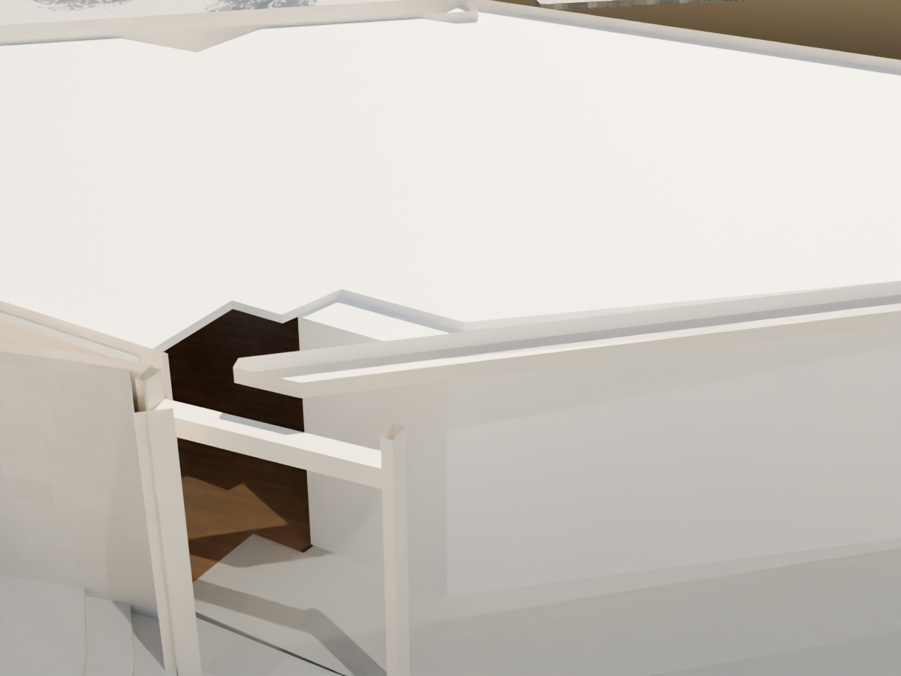
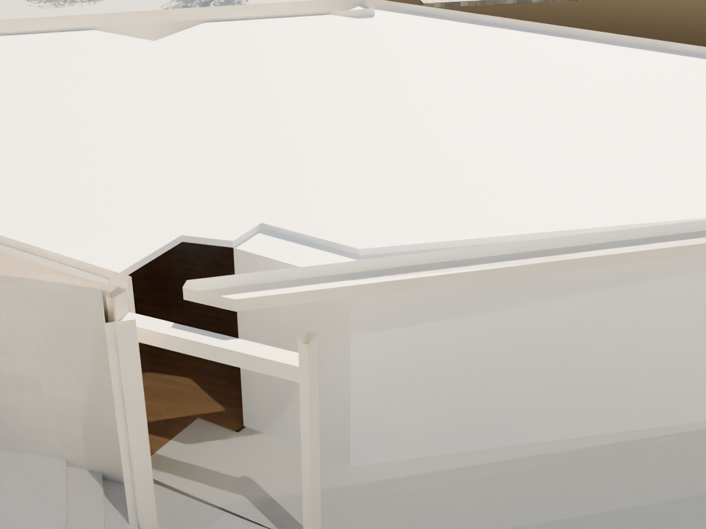
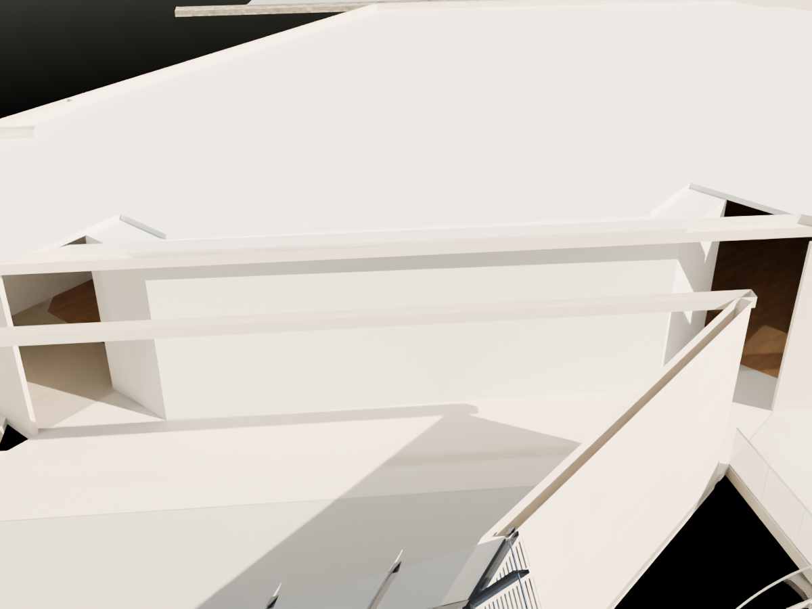

# R100 — Galeri tavan–duvar temasları

R99 sahnesindeki doğu ve batı galeri asma tavan kenarlarının mevcut kısa giriş duvarlarıyla farklı bitmesi düzeltildi. Yalnız `R28_E_FLAT_CEILING` ve `R28_W_FLAT_CEILING` değişti. Dokuz XY noktası (18 alt/üst köşe) duvar iç yüzüne taşındı; tavan kotu ve kalınlığı değişmedi.

Kaynak: arşivdeki resmî 102 zemin kat şeması, 2016 Mudam PDF galeri sınırları ve bunlardan üretilmiş `config/ground_gallery_access.json`. Fotoğraf 026 Grand Hall merdiveni yanındaki yüksek geçidin gerçek olduğunu gösterir; bu geçit rastgele bir duvarla kapatılmadı. Kullanıcının son iki galeri ekran görüntüsü R99 referans klasöründe saklıdır.

## Kontroller

- Önce en büyük yerel kenar farkı 0,337368 m; sonra kontrol edilen eşleşmelerde 0 m. Bu model koordinat kontrolüdür, saha ölçüsü değildir.
- Sahne yeniden açıldı: 8.370 görünür nesne; sayısal geometri ve açık mesh kontrollerinde hata yok.
- Önceki sahneyle fark: yalnız iki tavan mesh'i değişmiş.
- R99 kısa giriş duvarının 15 probu ve kuzey/güney geçitlerinin altı tam sahne ışın testi geçti.
- Aşağıdaki aynı kamera ve kesit aralığındaki dört görsel açılıp incelendi.

| Alan | Önce | Sonra |
| --- | --- | --- |
| Doğu merdiven köşesi |  |  |
| Batı giriş kenarı |  |  |

## Açık sınırlar

Bu paket tüm ekran görüntülerinin kabulü değildir. Giriş uçlarındaki gerçek geçişler korunur. Tavanın 4,35–4,50 m kotları ve haritadan elde edilen genel ölçek koşulludur. Üst kat Studio/servis/asansör çevresinin katlar arası ilişkileri ve bütün bina kabuğu ayrıca kontrol edilecek. Kesin uygulama detayı veya ölçülmüş rölöve iddiası yoktur.
