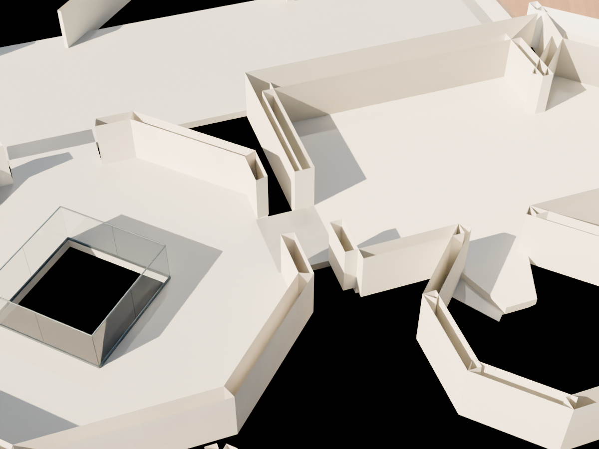
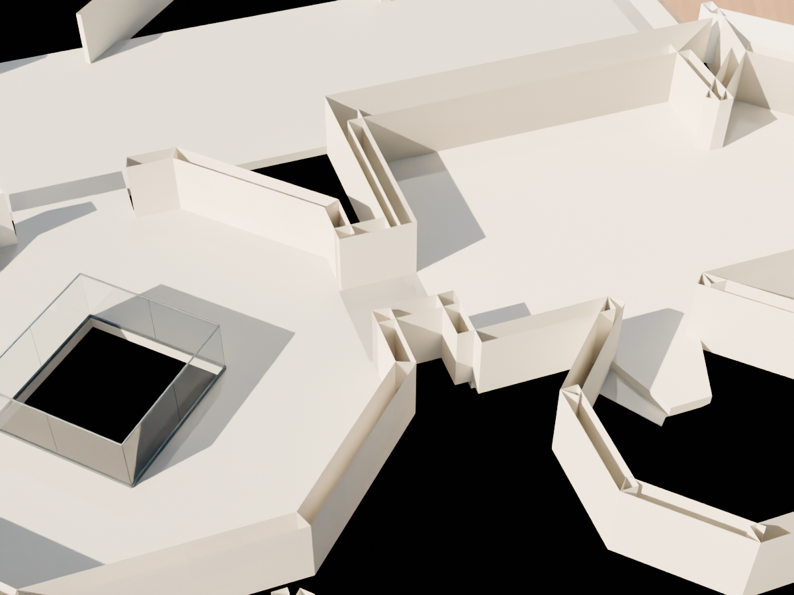

# R101 — Okuma odası–doğu servis odası geçidi

2016 resmî PDF +1 planında çizili kısa bağlantının iki yan duvarı R96 üretiminde atlanmıştı. R100 sahnesindeki boşluklar beş konumda üç yükseklikte yapılan tam sahne ışın kontrolleriyle doğrulandı. Eksik iki duvar R101'e eklendi; kapı açıklığı korunuyor. Diğer mevcut nesneler değiştirilmedi.

Kuzey duvarı mevcut kuzey birleşim parçasına, güney duvarı servis odasının dönüşüne bağlanır. Sınırlar `R96_build_report.json` oda poligonunun 9 ve 11. kenarlarıdır; 10. kenar geçiş açıklığıdır. Okuma odasının önceden uyarlanmış iç yüzüyle temas korunur. Kaynak görsel: `references/R96_front_pdf_crop.png`; kaynak PDF SHA ve sayfa bilgileri `config/reading_room.json` içinde.

## Kontroller

- Yeniden açılan sahnede 15 yan duvar kontrolü: önce 15 eksik, sonra sıfır.
- Üç yatay güzergâhta üç yükseklik: dokuz geçiş kontrolü açık.
- Bağlantının dört noktasında zemin ve tavan: sekiz kontrol geçti.
- Toplam 32 bölgesel kontrol geçti. Genel geometri kontrolü ve yalnız iki nesne eklendiğini doğrulayan sahne farkı kontrolü geçti.
- Ek olarak Studio, doğu servis odası ve asansör sahanlığının kaynak iç sınırlarında zemin/tavan örneklemesi ve dört bağlantı güzergâhında geçiş kontrolü yapıldı: 840 kontrol, sıfır eksik. Sonuç `R101_upper_front_inspection.json` içindedir. Bu kontrol diğer duvarların bütün yüzlerini veya kaynak ölçülerinin kesinliğini onaylamaz.
- Aynı kamera ve kesit aralığındaki aşağıdaki önce/sonra görselleri açılarak incelendi. Siyah bölgeler kesit dışında kalan yüzeylerdir; duvarların üst yüzlerinin kesitte açık görünmesi shader kesitinden kaynaklanır.

## Sınırlar

Bu, fotoğrafı bulunmamış özel oda bağlantısının kaynak plan topolojisine göre tamamlanmasıdır. 0,30 m kalınlık ve 2,70 m yükseklik adaydır. Mevcut plan uyarlaması korunmuştur; ölçülmüş uygulama projesi değildir. Studio, asansör ve diğer üst kat ilişkilerinin tümü bu paketle tamamlanmış sayılmaz.
