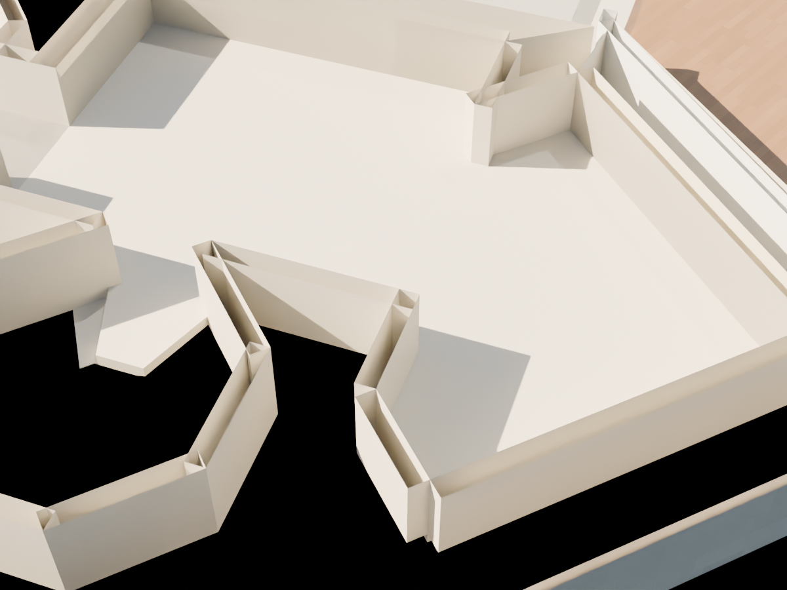
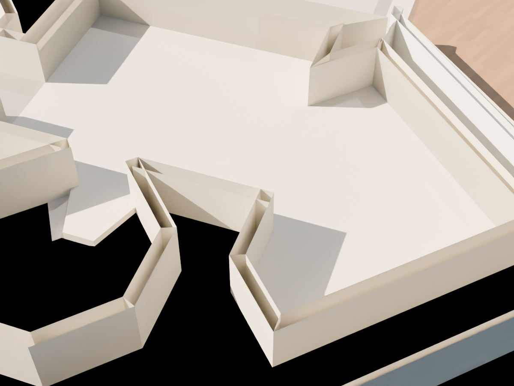

# R102 — Üst servis odası ve merdiven kuyusu köşeleri

2016 resmî PDF'nin üst kat oda ve merdiven sınırlarıyla aynı iç çizgiler korunarak 14 duvarın 12 dış köşesi birleştirildi. Önceki parçaların dış yüzleri ayrı uçlarda bitiyor, köşelerde boşluk veya üst üste gelen çıkıntılar bırakıyordu. Dış uçlar, iki duvarın ortak köşe noktasına taşındı. Kapılar, basamaklar, döşemeler, tavanlar ve duvar yükseklikleri değişmedi.

Kaynak konturu `R96_build_report.json` içindeki `documentation_east_room` ve `service_stair_boundary`; kaynak görsel `references/R96_front_pdf_crop.png`. Bu, var olan plan konturundaki kalınlık geometrisinin onarımıdır. Yeni oda veya yeni duvar izi önerilmez. Duvar kalınlığı hâlâ ölçülmemiş 0,30 m adaydır.

- Sahne yeniden açıldı; 24 köşe probunda önce boş olan 10 konum artık duvar içinde.
- Her komşu duvarın dış ucu ortak köşeyle karşılaştırıldı; iç yüz ve yüksekliklerin korunduğu denetlendi.
- Genel geometri ve sahne farkı kontrolleri geçti; değişenler yalnız belirtilen 14 duvar.
- Servis merdiveninin 110 basamak/baş mesafesi/geçiş kontrolü yeniden geçti.
- Dört üst oda içindeki 11.178 örnekte, kaynak sınırından en az 0,40 m içeride başka bir duvar gövdesi taşması bulunmadı (`R102_upper_interior_intrusions.json`). Kenar şeritlerinin tamamı bu teste dahil değildir.
- Altı merdiven grubunun basamak içlerinde 2.182 noktada 2,10 m düşey kontrol yapıldı; çakışma bulunmadı (`R102_stair_width_clearance.json`). Bu bir geometri kontrol mesafesidir; mevzuat veya gerçek rıht ölçüsü kabulü değildir.
- Aşağıdaki aynı kamera ve kesit aralığındaki önce/sonra görselleri açılarak incelendi. Kesit üstünde kapak göstermeyen shader, duvarın gerçek modelde açık mesh olduğu anlamına gelmez.

Bütün üst katın veya binanın kabulü değildir. Katlar arası kabuk ilişkileri, diğer duvar birleşimleri ve gerçek ölçü belirsizlikleri açık kalır.
