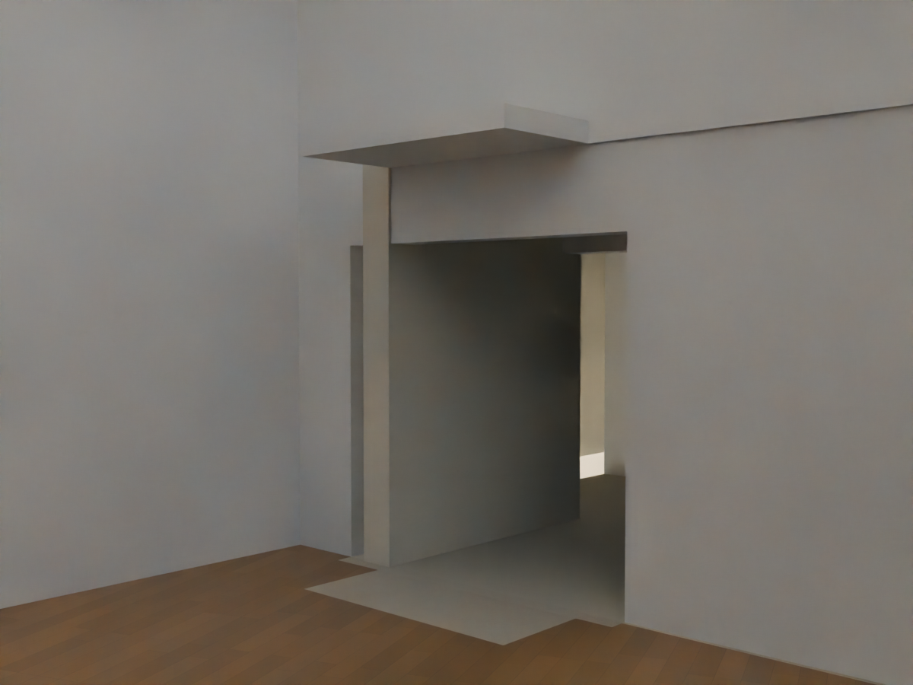
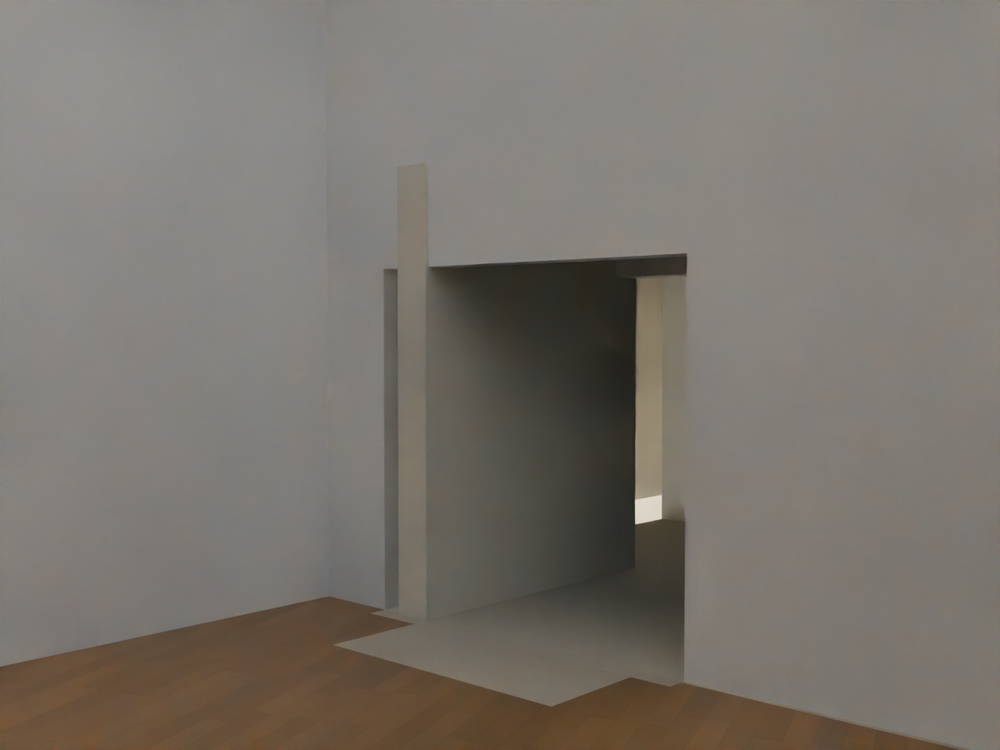
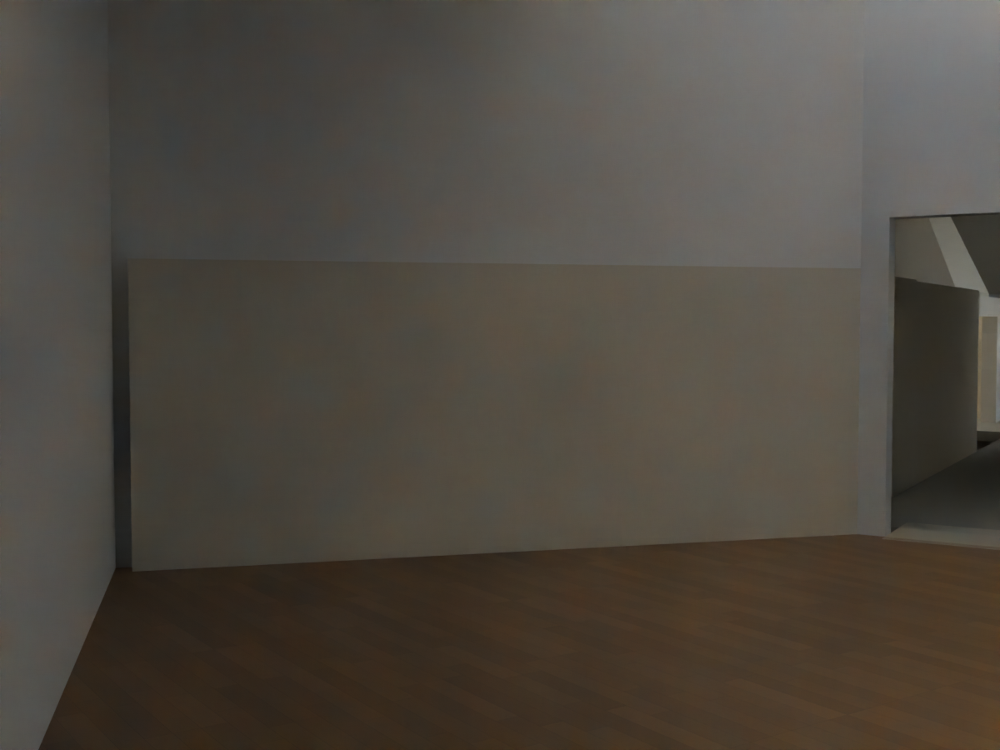
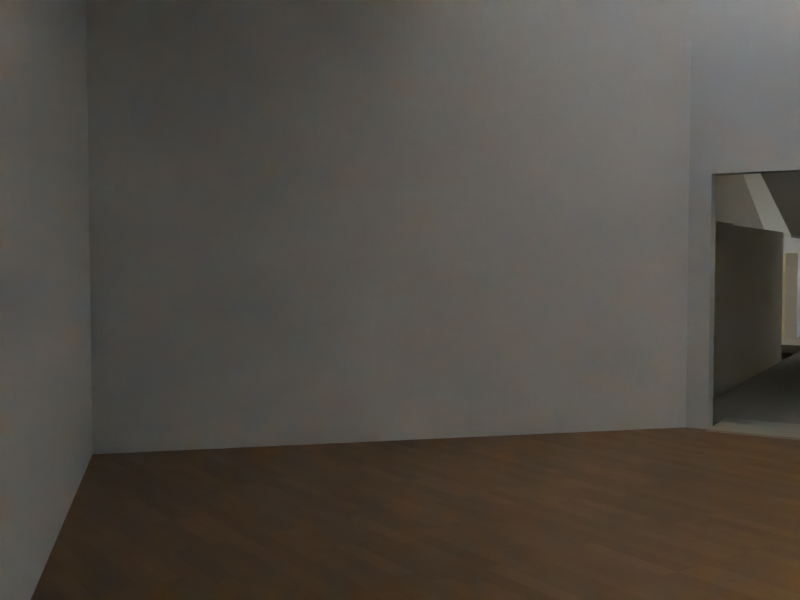

# R103 — Üst galeri iç yüz birleşimleri

Batı üst galerinin iç yüzünü aşan dört komşu duvar/tavan parçası düzeltildi. Galerinin PDF2016'dan aktarılan mevcut iç konturu, kapı açıklıkları ve yükseklikleri korundu.

- `R96_DOCUMENTATION_GALLERY_JOIN`: servis odası birleşiminin galeriye taşan, yaklaşık 18 cm'ye ulaşan kısmı kaldırıldı.
- `R85_RETURN_OUTER_TIP` ve `R85_RETURN_CEILING_0`: merdiven dönüşündeki yaklaşık 4 cm'lik taşmalar giderildi.
- `R85_RETURN_CEILING_1`: galeri köşesine yaklaşık 1 metre uzanan yanlış tavan parçası galeri poligonuyla kesildi. Koridorun dışarıda kalan iki kolu korundu.

Kaynaklar: `config/upper_gallery_room.json` içindeki PDF2016 galeri sınırı ve kapı uçları, resmî 103 üst kat şeması, `references/R96_front_pdf_crop.png`. Galeri iç hacmi için UG02/UG03 ve UC02 fotoğrafları karşılaştırma kaynağıdır; bu fotoğraflar kapı kasası veya bütün duvar ölçülerini doğrulamaz. Yeni oda, kapı veya taşıyıcı uydurulmadı.

Sayısal mesafeler aday modeldeki uyumsuzluklardır; sahada ölçülmüş bina boyutları değildir. Kırpılan parçalar, çakışan görünür yüzler oluşmaması için mevcut 250 mm galeri duvarının iç yüzünden 5 mm geride sonlandırıldı. Bu bitiş duvar gövdesi içindedir, açık derz değildir.

## Doğrulama

Sahne yeniden açıldı. Dar taramanın kaçırdığı ikinci tavan parçası, yakın render ve 3 metre derinlikli taramayla bulundu; ilk aday kabul edilmedi. Son dosya `MUDAM_R103_UST_GALERI_IC_YUZ_BIRLESIMLERI_v003.blend`.

- İki galeri iç yüzünde sekiz yükseklikten 11.378 dar ve 11.378 derin ışın: son sahnede taşma bulgusu yok.
- Değişen dört parça kapalı; hacimleri pozitif, yükseklikleri aynı.
- Genel geometri kontrolü ve sahne farkı: hata yok, yalnız dört belirtilen parça değişti.
- Galeri kapıları, dönüş güzergâhı, zemin desteği ve baş mesafesi regresyonu geçti.
- Batı üst sahanlık ve dönüşün 571 örneğinde alt, üst ve yan kapanış kaybı yok.
- Aynı kamera ve pozlama ile alınan aşağıdaki görüntüler açılıp incelendi. Aydınlatma kalibrasyonu ve malzeme kabulü bu paketin kapsamı değildir.

### Merdiven dönüşü — önce / sonra

### Servis odası birleşimi — önce / sonra

Bütün bina veya bütün ekran görüntüleri için kabul verilmedi. Diğer kabuk birleşimleri ve kat ilişkileri kaynaklarla karşılaştırılmaya devam ediyor.
