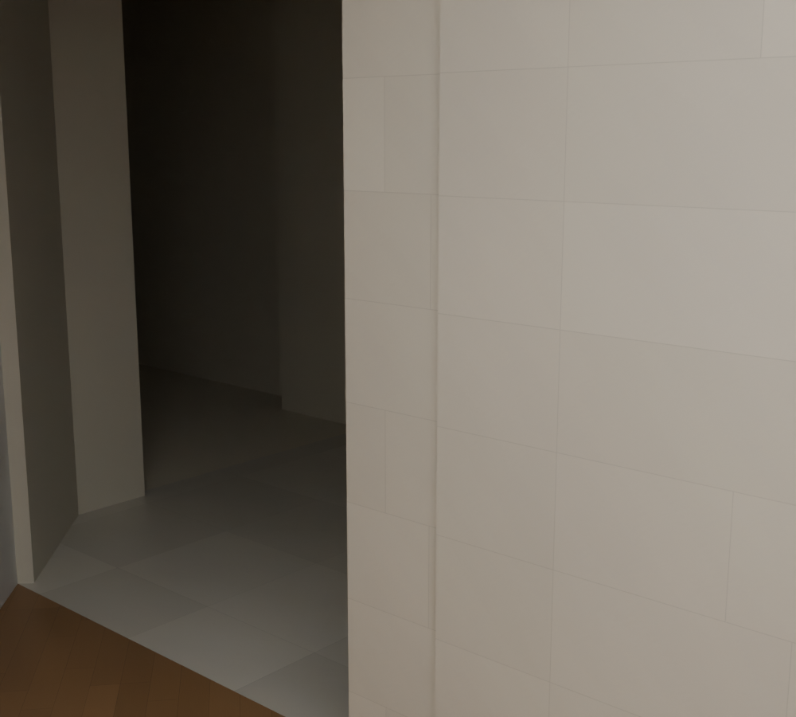
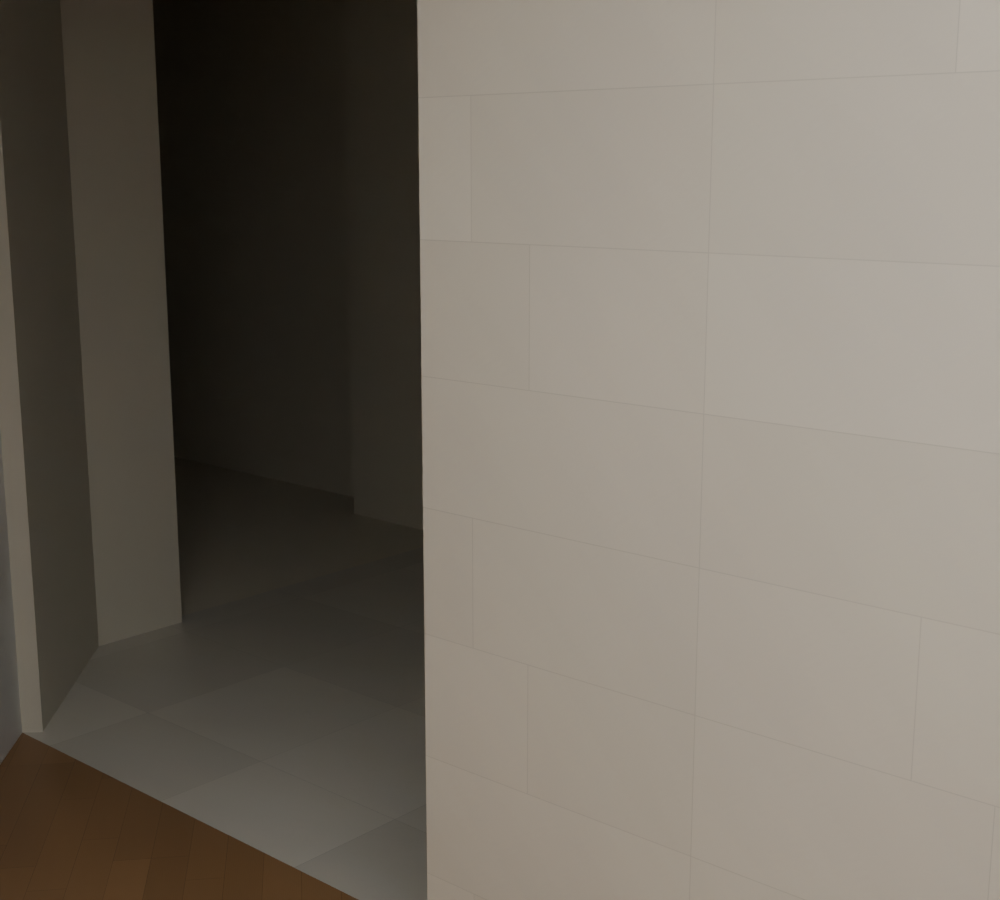

# R104 — Alt merdiven duvarının devamı

Alt batı galeri girişinde `R29_W_DIVIDER_END` duvarının galeriye bakan yüzü, birleştiği `R07_STAIRWELL_STONE_WEST` yüzünden 50 mm geride kalıyordu. Dört arka köşe komşu duvar yüzüne taşındı. R76'da kabul edilen ön yüz, kaynakta açık kalan giriş ucu, üst ve alt kotlar korundu.

Kaynak 104 sürekliliği ve mevcut R76 duvar eşleştirmesi esas alındı. 051/052/055 fotoğrafları merdiven–fuaye mimarisini gösterir; galeri arka yüzünün 300 mm kalınlığını ölçmez. Bu işlem iki mevcut parça arasında geometrik uyum sağlar; gerçek duvar kalınlığının ölçümü değildir. Komşudan devralınan 300 mm hâlâ adaydır.

## Kontroller

- Yeni sahne yeniden açıldı: dört arka köşe aynı düzlemde, diğer dört köşe sabit; yükseklik değişmedi.
- Kapalı mesh, pozitif hacim ve komşu duvarla kesişme korundu.
- Genel geometri kontrolü geçti. Sahne farkında yalnız bir duvar değişti.
- Alt galerilerin geçiş, zemin desteği ve baş mesafesi regresyonu geçti.
- Aynı kamera ve inceleme ışığı ile önce/sonra görüntüleri açılıp karşılaştırıldı. İnceleme ışığı sahneye kaydedilmedi.

Alt kat taramasında görülen diğer farklar, eski 104 şemasının döşeme sınırı ile R76'da komşu duvara uzlaştırılmış sınır arasındadır. Bunlar yeni hata sayılıp duvar geri taşınmadı. Alt galeri yüzey malzemeleri ve kesin kotlar için belirsizlikler sürüyor. Bütün bina tamamlandı denmedi.
