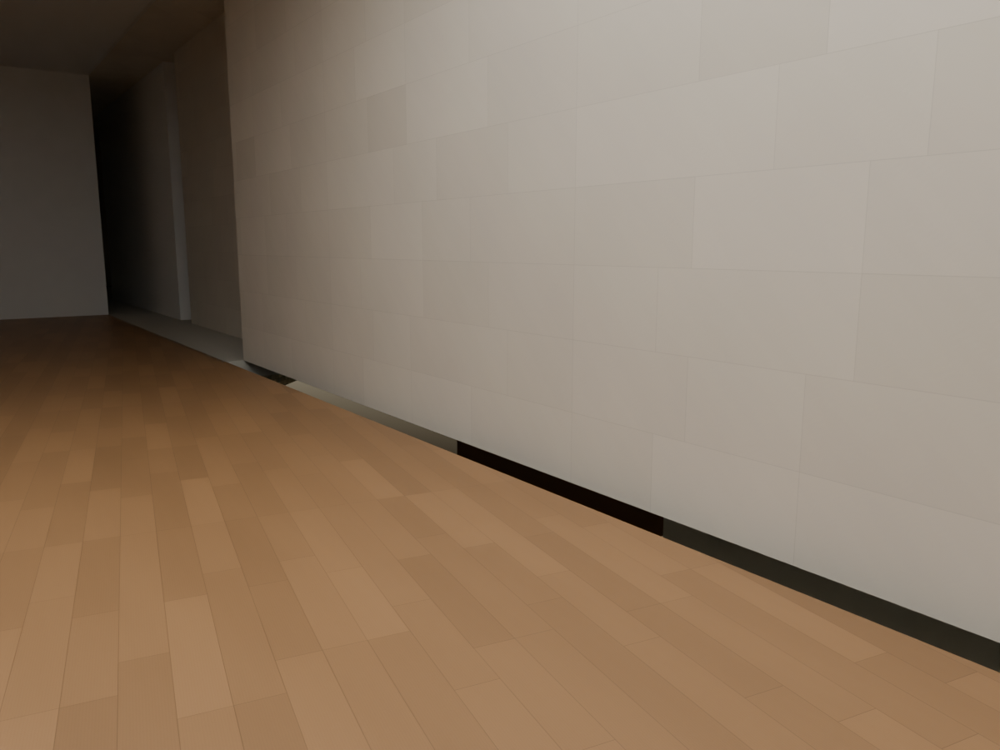
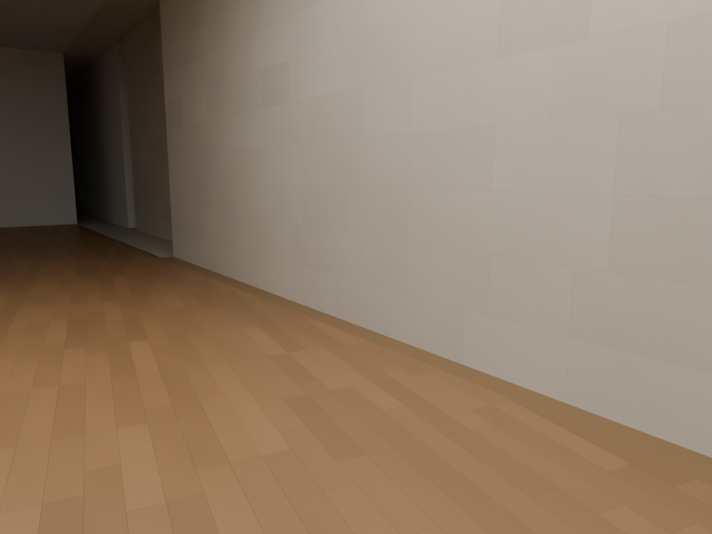
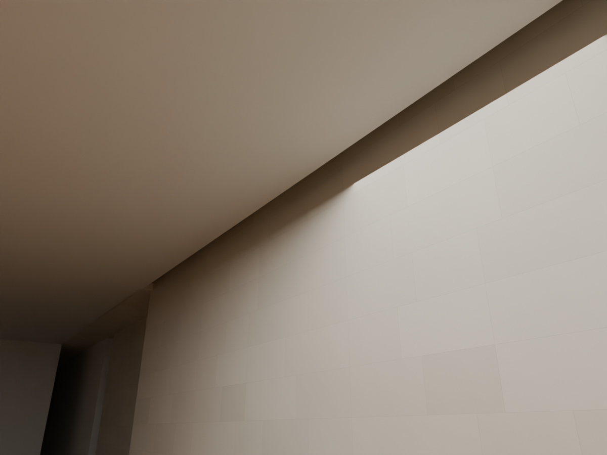
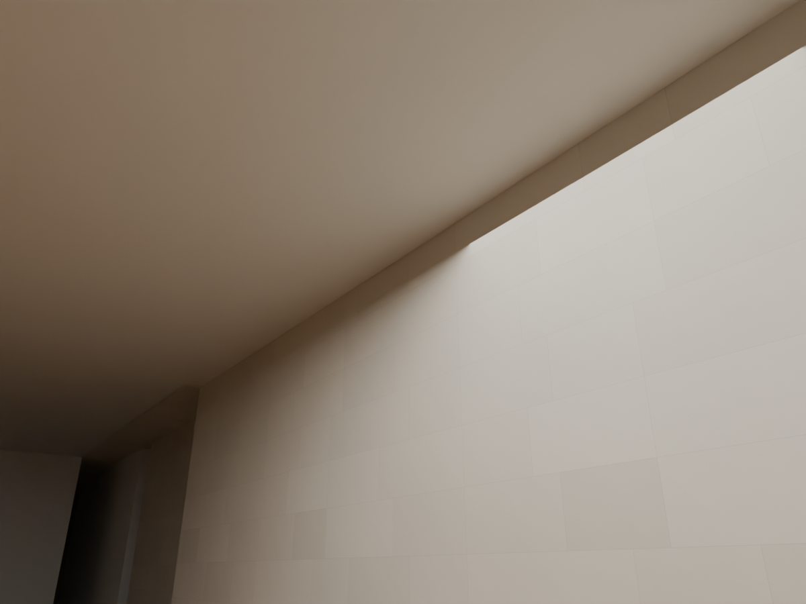

# R105 — Batı zemin galerisi döşeme ve tavan teması

Batı zemin galerisinin Grand Hall tarafındaki mevcut duvarı ile döşeme/tavan kenarı arasında modelde 199 mm fark vardı. İçeriden bakışta zeminin altında dışarıdaki yüzeyler görünüyordu. Önceki genel oda taraması, referans poligonunun dışında kalan bu dar şeridi örneklemediği için bu açıklığı yakalamamıştı.

`P05_FLOOR_L00_W0` ve `R28_W_FLAT_CEILING` yalnız bu duvar boyunca genişletildi. Ek hacimler mevcut nesnelere Boolean Union ile birleştirildi; üst üste duran ayrı döşeme yüzleri bırakılmadı. Duvarın yeri, giriş açıklıkları, zemin ve tavan kotları değişmedi. Duvar gövdesine 5 mm iç içe geçme görünür açık derz değildir.

Kaynak 102 zemin şeması ve mevcut PDF2016 sınırları, bu hat boyunca oda/dolaşım sürekliliğini gösterir. 056 fotoğrafı galeri döşemesi ile düz tavanın genel mimari karşılaştırmasıdır; bu batı kenarının ölçülmüş fotoğraf eşlemesi değildir. 199 mm, modeldeki iki farklı çizim aktarımının farkıdır; yapıda ölçülmüş bir boyut değildir. Kalınlıklar ve kotlar aday olarak kaldı.

## Kontroller

- Son sahne yeniden açıldı: `MUDAM_R105_BATI_GALERI_DOSEME_TAVAN_TEMASI_v002.blend`.
- Beş enine hat, 103 boyuna istasyon ve iki yüz: 1.030 yerel kontrol. Önce 1.020 temas eksikliği, sonra sıfır.
- Tam sahne geometri kontrolü: açık veya geçersiz mesh bulgusu yok.
- Sahne farkı: yalnız yukarıdaki iki nesnenin geometrisi değişti.
- Dört galeri girişinin 108 geçiş, döşeme desteği ve baş mesafesi kontrolü geçti. Eski R28 nesne listesine bağlı test, artık bulunmayan bir nesne adı nedeniyle çalışmadı; güncel sahnenin tüm görünür geometrisini kullanan ayrı güzergâh kontrolü yapıldı.
- İki zemin galerisi boyunca gerçek duvar yüzlerinin 15 mm içinden alınan 3.074 ek döşeme/tavan temas örneğinde eksiklik bulunmadı. Bu tarama oda poligonunun dışında kalabilen dar şeritleri de kapsar; gerçek açıklıklar ve duvar bulunamayan doğrultular için ayrı değerlendirme gerekir.
- Aynı kamera/inceleme ışığı ile iki açıdan önce/sonra görüntüleri açılıp karşılaştırıldı. İnceleme ışıkları modele kaydedilmedi.

### Döşeme — önce / sonra

### Tavan — önce / sonra

Bu yerel birleşim kabulü bütün binanın veya tüm katların tamamlandığı anlamına gelmez. Diğer referans sınırlarının dışında kalan dar temas şeritleri de kontrol edilmeli. Sanat veya geçici sergi öğesi eklenmedi.
