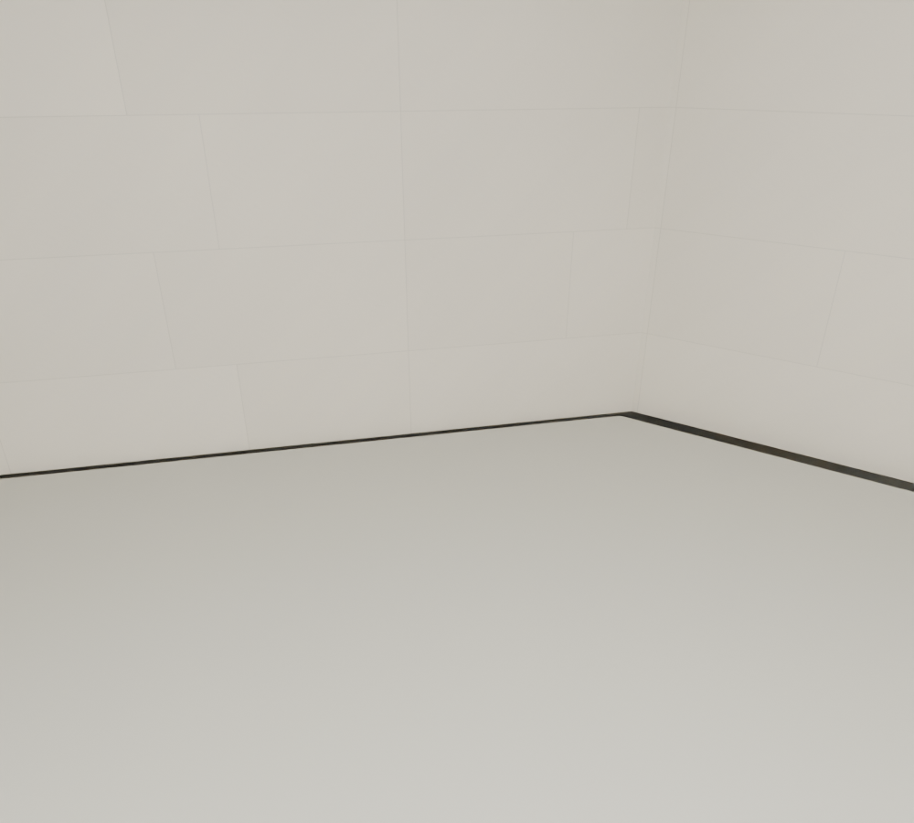
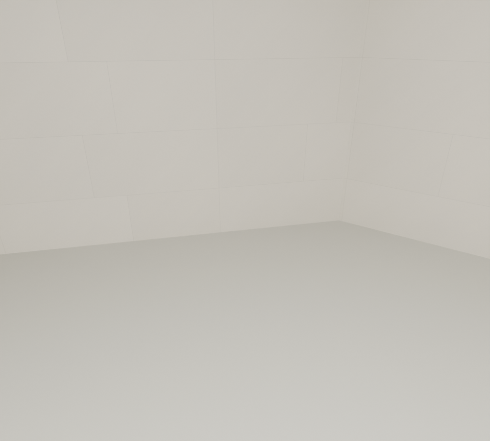

# R107 — Okuma odası döşeme–duvar teması

Okuma odasının eski P17 döşeme dış konturu, daha sonra PDF2016 ile düzeltilen R09 duvar konturuna uymuyordu. Güney ve güneydoğu duvarlarının dibinde açık şerit vardı. P17'nin elle çizilmiş sekiz dış köşesi, mevcut R09 oda iç sınırına ve duvarın içine gömülü 5 mm temasa taşındı. Duvarlar değiştirilmedi.

Ortadaki kare boşluğu kesen nesne, üç geçidin döşeme birleşimleri, kat kotu, döşeme kalınlığı ve korkuluklar korundu. R106 yerel denemesi geometri değiştirmediği için kabul edilmemişti; R107 doğrudan kabul edilmiş R105 sahnesinden üretildi.

Kaynaklar: `reading_room.json` içindeki PDF2016 konturu; 103 üst kat ziyaretçi şeması; 015/016 fotoğraflarında üst döşeme boşluğu ve odanın mimari ilişkileri. Fotoğraflar bu kenar farklarını ölçmez. Yapılan işlem iki eski aktarımı aynı duvar sınırına uzlaştırır; röleve veya kesin ölçü kabulü değildir.

## Kontrol

- Sahne yeniden açıldı; 1.313 döşeme çevresi, iç alan ve merkez boşluk kontrolü geçti. Önceki sahnede başarısız 98 örnek vardı.
- Üç geçidin 36 geçiş/döşeme desteği/baş mesafesi kontrolü geçti.
- Genel sahne geometri kontrolünde hata yok.
- Sahne farkında yalnız `P17_READING_FLOOR` değişti. Yeni oda, duvar veya sanat öğesi eklenmedi.
- Aynı kamera ve inceleme ışığıyla önce/sonra görüntüleri açılıp karşılaştırıldı; duvar dibindeki açıklık kapanıyor. İnceleme ışığı sahneye kaydedilmedi.

Son yerel sahne: `MUDAM_R107_OKUMA_DOSEME_DUVAR_TEMASI_v001.blend`. Bu kabul okuma odasının döşeme temasıyla sınırlıdır. Diğer küçük odaların üst örtüleri, kalan çelik/cam birleşimleri ve bütün bina son kontrolü açık kalır.

## Sonraki temas taramaları — geometri değişikliği değildir

- Studio, okuma odası, doğu servis odası ve asansör sahanlığında gerçek duvar yüzünün 15 mm içinden 1.882 döşeme/tavan örneği: eksik temas bulunmadı. Bu tarama eksik duvarları veya bütün oda hacmini tek başına doğrulamaz.
- Ana cam örtünün 932 profilinde 1.864 uç kesiti: komşu profile temas etmeyen örnek bulunmadı.
- Yan cam örtülerin 901 profilinde 1.802 uç kesiti: komşu profile temas etmeyen örnek bulunmadı. İlk tarama 216 eğik profil kesitini kapsamıyordu; iki aday uç bu profillere zaten temas ediyordu. Afin kesit hesabı eklendikten sonra bütün 901 profil kapsandı. Bu iki uç uzatılmadı.
- Profil kontrolleri dokuz uç kesit örneği ve 1 mm tolerans kullanır; birleşim donanımı, kaynak/cıvata ayrıntısı veya statik yeterlilik doğrulaması değildir.

Ham kayıtlar: `R107_upper_small_room_shell_contacts.json`, `R107_main_frame_end_contacts.json`, `R107_side_frame_end_contacts.json`. Bütün bina ve bütün cam/taş birleşimleri kabulü henüz yoktur.
