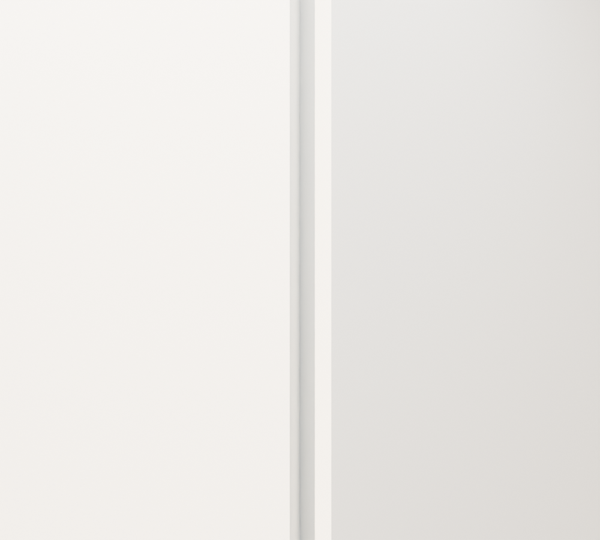

# R108 — Zemin servis duvar köşeleri

WC, vestiyer ve dükkân sınırlarında ortak plan noktasında birleşen 15 mevcut duvarın 11 köşesi gönye birleşimine çevrildi. Önceki dik kesilmiş uçlar dış köşelerde eksik üçgen kesitler bırakıyordu. Kaynak eksenleri, duvar yüzlerinin doğrultusu, kalınlık, kotlar ve kapı uçları korunarak yalnız ortak köşe uçları düzenlendi.

Kaynak: 102 zemin şeması ve `ground_service_rooms.json` içindeki PDF2016/path120 duvar izleri. Yeni bölme veya açıklık üretilmedi. 25 cm mevcut kalınlık ölçülmüş bilgi değildir; birleşim aynı kalınlıktaki mevcut duvarları uzlaştırır.

## Doğrulama

- Yeni sahne yeniden açıldı: 44 köşe örneği geçti; eski sahnede açık olan 22 örnek kapandı.
- 15 duvar pozitif hacimli, kapalı ve hatasız yüzlere sahip. Değişen köşelerin Z koordinatları sabit.
- Genel geometri kontrolü geçti. Sahne karşılaştırması yalnız raporda belirtilen 15 duvarın değiştiğini doğruladı; yeni nesne yok.
- Servis alanlarında 18 geçiş ışını ve 78 destek/baş mesafesi örneği geçti.
- Aşağıdaki iki yakın görüntü aynı kamera ile açılıp karşılaştırıldı. Birleşimi görünür kılmak için yalnız `R33_WALL_CLOAK_SW` ve `R33_WALL_CLOAK_S` gösterildi; bu görünürlük ayarı üretim sahnesine kaydedilmedi. Tüm sahnede çevredeki başka duvarlar bu küçük birleşimi kısmen örtebiliyor.

Yerel sahne: `MUDAM_R108_ZEMIN_SERVIS_DUVAR_KOSELERI_v001.blend`. Bu kabul 11 birleşimle sınırlı; bütün bina, detay ölçüleri veya taşıyıcı sistem kabulü değildir.
