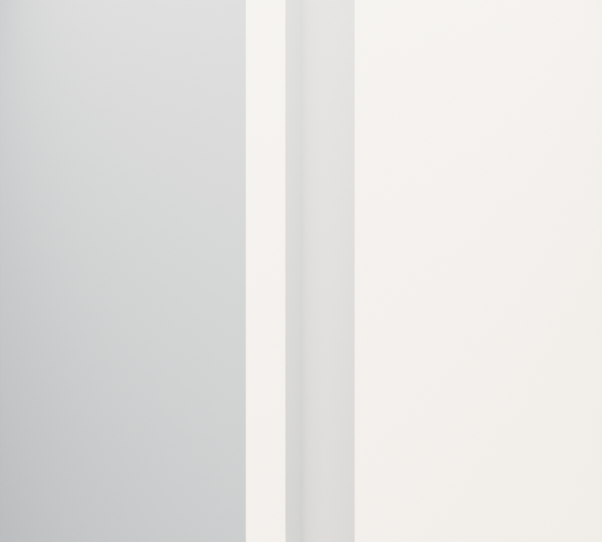
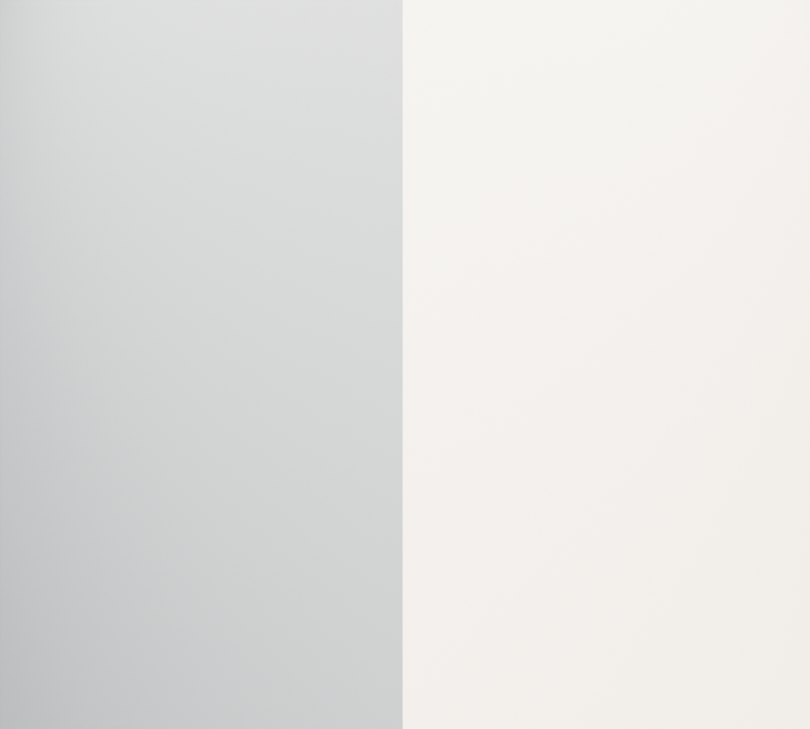

# R109 — Servis merdiveni altındaki duvar köşeleri

R108'den ayrı tutulan, daha önce merdiven kapısı için kesilmiş üç zemin servis duvarının iki ortak köşesi birleştirildi. Yalnız mevcut köşe uçlarının XY konumları değişti. R97 kapı kesisi, merdiven, kaynak eksenleri, duvar yüzlerinin doğrultusu, kalınlığı ve yükseklikleri korundu.

Kaynaklar: R33/PDF2016 plan izleri ve 102 zemin şeması. İşlem mevcut izlere dayanan süreklilik düzeltmesidir; kalınlık ve kotlar ölçülmüş kabul edilmez.

- Yeni sahne yeniden açıldı. Sekiz köşe örneği geçti; önceden açık dört örnek kapandı.
- Üç değişen duvar kapalı ve pozitif hacimli. Genel sahne denetiminde hata yok.
- Sahne farkı yalnız `R33_WALL_SERVICE_W_N`, `R33_WALL_SERVICE_W_E`, `R33_WALL_SERVICE_W_W` nesnelerini gösteriyor.
- Servis merdiveninin basamak, geçiş, baş mesafesi ve destek kontrolleri yeniden geçti (`R109_service_stair_regression.json`).
- Aşağıdaki görüntüler aynı kamerada iki duvar izole edilerek incelendi. İnceleme için diğer nesnelerin gizlenmesi üretim sahnesine kaydedilmedi.

Yerel sahne: `MUDAM_R109_SERVIS_MERDIVEN_ALTI_KOSELERI_v001.blend`. Bütün bina kabulü ve kaynakta ölçüsü bulunmayan detayların doğrulaması açık.
