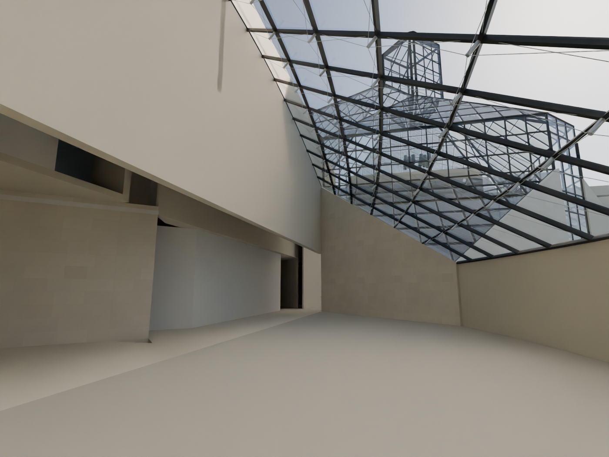
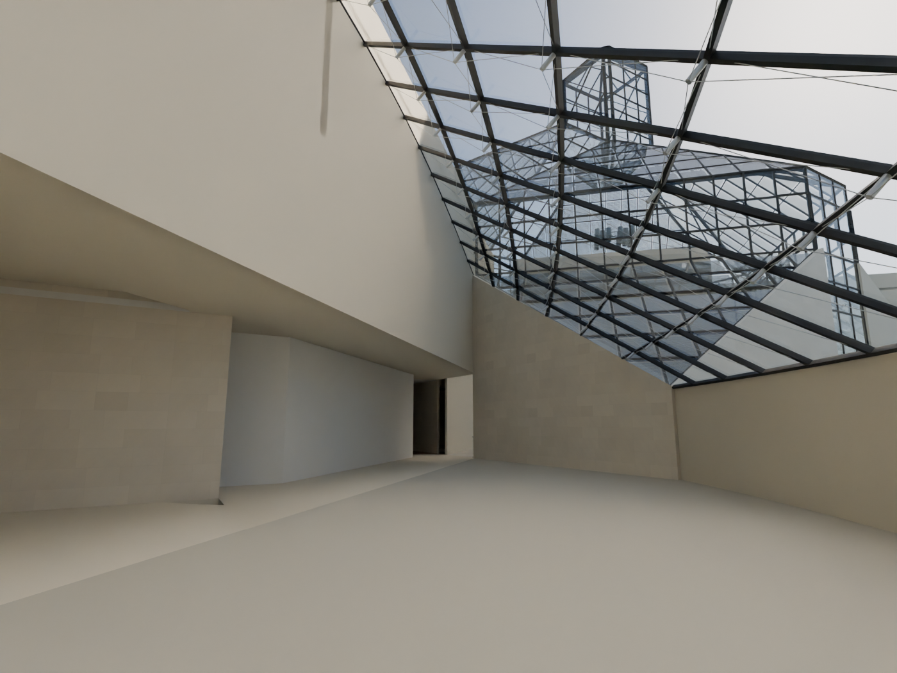

# R111 — Kafe tarafındaki büyük yatay örtü açıklığı

R95, kullanıcının plan düzeltmesi doğrultusunda uzun kafe duvarının zemin kat bölümünü kaldırmıştı. Geçit açık kalmış, fakat arkasındaki galeri yaklaşım alanında galeri tavanına bağlanan alt örtü eksik kalmıştı. Bu nedenle R109 iç görünüşünde üst duvar ile zemin kat sınırı arasında geniş yatay yarık görülüyordu.

Yeni `R111_W_GALLERY_APPROACH_SOFFIT` mevcut geçit sınırı boyunca üst örtüyü birleştirir. Uzun zemin duvarı geri eklenmedi. Kuzey bitişi v=578 ile ayrı batı merdiveninin önünde durur; arka sınır R96'da korunan küçük üst oda döşemesine ulaşır. Doğudaki fotoğraf 026/033'te görülen yüksek geçit kapatılmadı.

Dayanaklar: 102 ve PDF2016 geçit düzeni, mevcut kaynak konturları, 093'teki kafe üst duvarı ve kullanıcının SS4 düzeltmesi. Örtünün 4,35–4,50 m kotları mevcut galeri tavanından devralınan aday değerlerdir. Kaynaklar bu kotları, kalınlığı ve gizli taşıyıcı sistemi ölçülendirmez; bu bir uygulama projesi değildir. Örtü yeni kullanılabilir bir +1 kat alanı olarak tanımlanmadı.

- R111 v001 orta kısmı kapatıp kuzey açıklığını bırakıyordu; kabul edilmedi.
- R111 v002 yeniden açıldı. Eski sahnede 132 örnek nokta örtüsüzken yeni sahnede bu örneklerde eksik örtü yok.
- Genel geometri kontrolü ve zemin galeri güzergâh kontrolleri geçti.
- Sahne karşılaştırmasında yalnız bir yeni örtü nesnesi var; mevcut duvar, döşeme, merdiven ve açıklıklar değiştirilmedi.
- Aynı kameradaki bütün sahne renderları açılıp karşılaştırıldı. R111 v002'de işaretli yatay yarık görünmüyor; alt geçit açık.

Son yerel sahne `MUDAM_R111_KAFE_GECIT_UST_ORTUSU_v002.blend`. Doğu merdiveni–duvar birleşimi ve bütün bina kabuğu kabulü henüz tamamlanmadı; sıradaki öncelik bunlardır.
