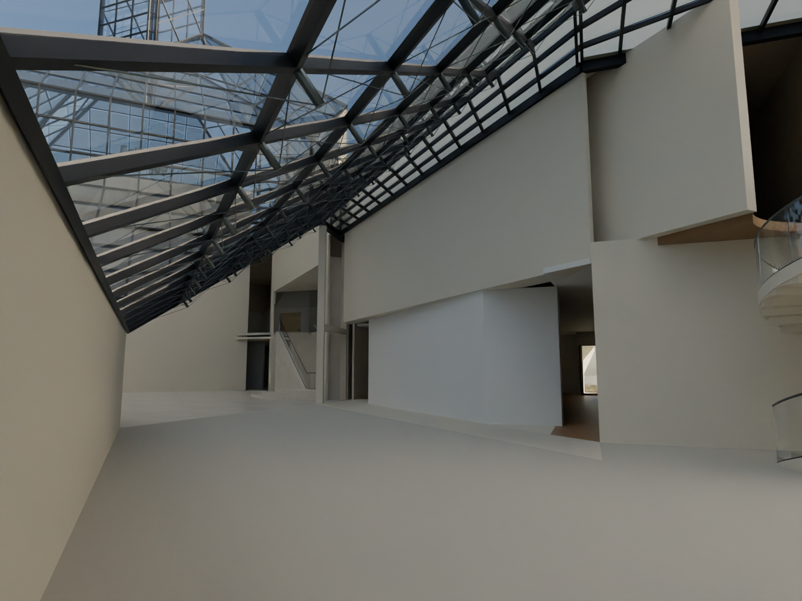
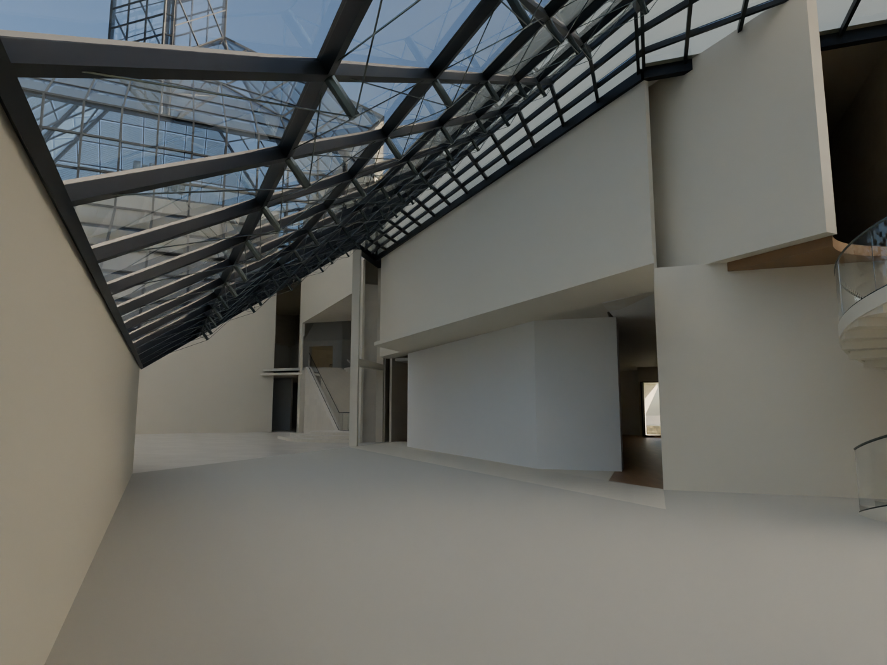

# R112 — Doğu galeri girişinin üst örtüsü

Doğu cam salonundan alınan R111 görünüşü, galeri girişindeki kısa duvarın üstünde de eksik tavan bağlantısını gösterdi. R112 mevcut zemin yaklaşım poligonunda örtü oluşturur; merdiven ve x=444 doğusundaki yüksek atrium geçidi bu parçanın dışında kalır. 026 ve 033 fotoğraflarında görülen yüksek açıklık duvarla doldurulmadı.

Kaynaklar 102/PDF2016 giriş sınırları, 026/033 yüksek geçit ve 034 cam salon–galeri–merdiven ilişkisi. Alt örtü 4,35–4,50 m mevcut galeri tavanı adayıyla birleştirildi; bu yükseklik ve kalınlık ölçülmüş proje verisi değildir. Yeni bir üst kat odası, sergi bölmesi veya sanat öğesi eklenmedi.

- Sahne tekrar açıldı; örneklenen 81 eski örtü eksiği kapandı.
- Genel geometri, sahne farkı ve zemin galeri geçiş kontrolleri geçti. Yalnız `R112_E_GALLERY_APPROACH_SOFFIT` eklendi; önceki nesneler değişmedi.
- Altı merdiven ailesinde mevcut basamak içlerinden yapılan baş mesafesi taramasında yeni engel bulunmadı. Bu, mevzuat/röleve kabulü değildir.
- Aynı kameradaki önce/sonra renderlar açılarak karşılaştırıldı. Örtü şeridi görünür biçimde tamamlanıyor. Sağ üstteki koyu küçük şekil için ayrıca ışınla nesne tespiti yapıldı: bu konumdaki ışınlar mevcut duvar/yeni örtü/galeri tavanı yüzeylerine çarpıyor; sırf koyu görünüyor diye ek duvar eklenmedi.

Yerel sahne `MUDAM_R112_DOGU_GALERI_GECIT_ORTUSU_v001.blend`. Bu paket giriş üst örtüsüne aittir. Merdiven biçimi, bütün kabuk sınırları ve tüm plan/kesit uyumunun son kabulü açık kalır. Öncelik büyük açıklıklardır.
