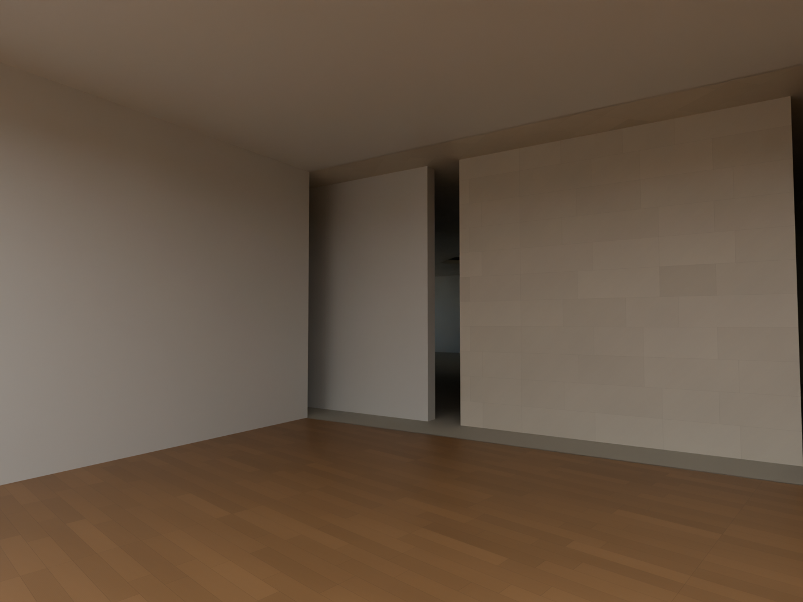
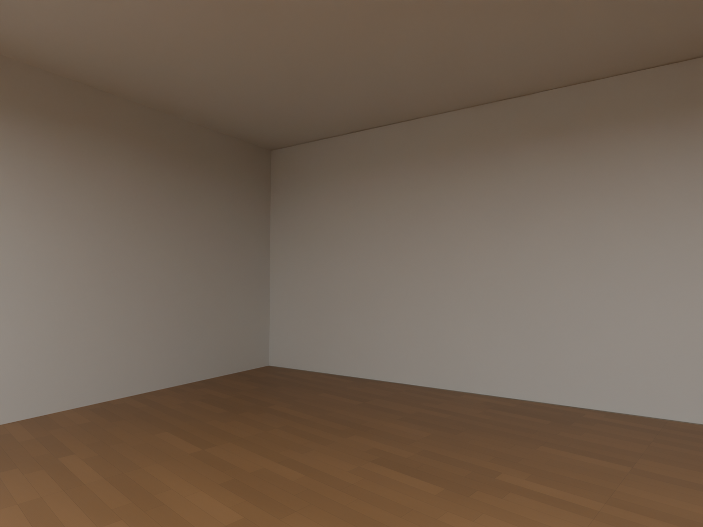
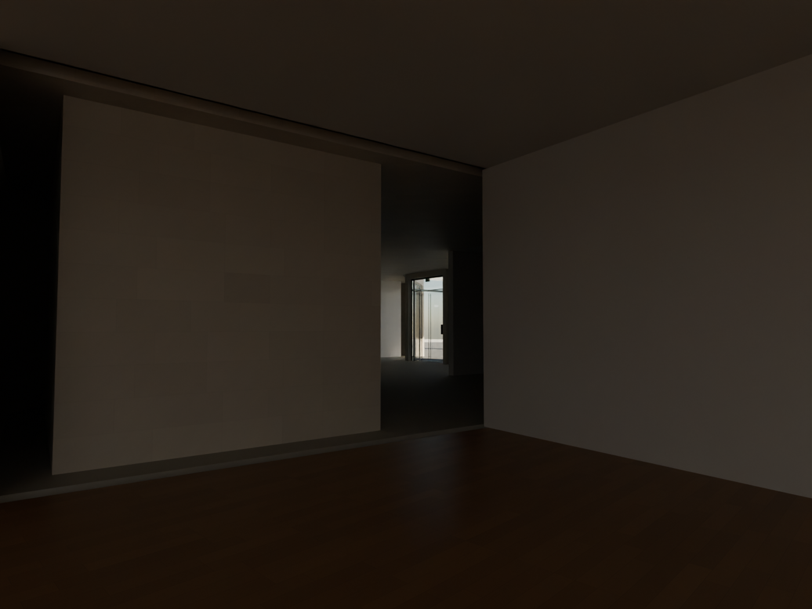
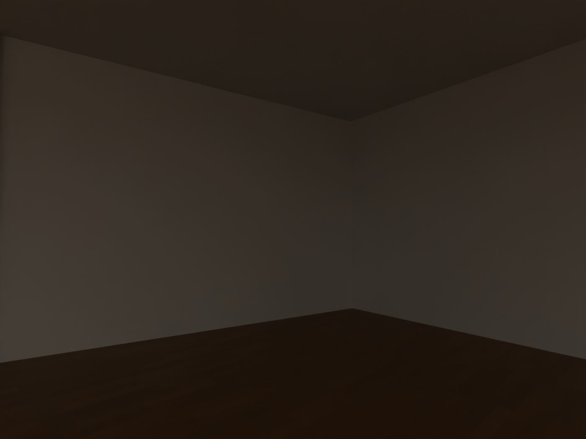

# R113 — Galeri–servis uzun duvarları

İki zemin galerisinin servis hacimlerine bakan uzun sınırında eksik duvar gövdeleri oluşturuldu. PDF2016 zemin planı ve 102 resmi kat şeması bu sınırları kesintisiz gösteriyor. Galeri iç yüzleri mevcut kaynak poligonunu izler; arka yüzler mevcut servis duvarı izine birleşir. Kalınlık ve 4,35 m üst kotu ölçülmüş uygulama detayı değildir.

İki yeni nesne eklendi; mevcut nesnelerde değişiklik yok. Yeniden açılan sahnede 360 eski eksik yüzey örneği kapandı. Genel geometri, galeri geçişleri ve servis geçişleri kontrollerinde bulgu yok. Bunlar bütün bina kabulü değildir.

## Aynı kamera karşılaştırması

Dört görüntü açılarak incelendi. Önceden galeri içinden servis koridorlarına görünen kaynak dışı yarıklar kapandı. Yasal galeri girişleri ve servis kapıları korundu.

## Kullanıcı ekran görüntüleri — güncel yeniden inceleme

Sağ cam birleşimi, sağ uç üst duvarı, sol cam birleşimi, doğu giriş duvarı ve kafe geçidi R113 sahnesinden yeniden render edildi ve açılarak incelendi. Bu alanlardaki önceki düzeltmeler korunuyor. R113 bu alanlara yeni geometri eklemedi; iki uzun servis sınırına müdahale etti.

Üst katın tüm oda/merdiven ilişkileri ve kullanıcının tüm işaretleri bu raporla tamamlandı sayılmaz. Üst kat kesitli görünümleri, galeri tavan şeritleri ve profil hizaları ayrı kontrol listesinde açık tutulur.
