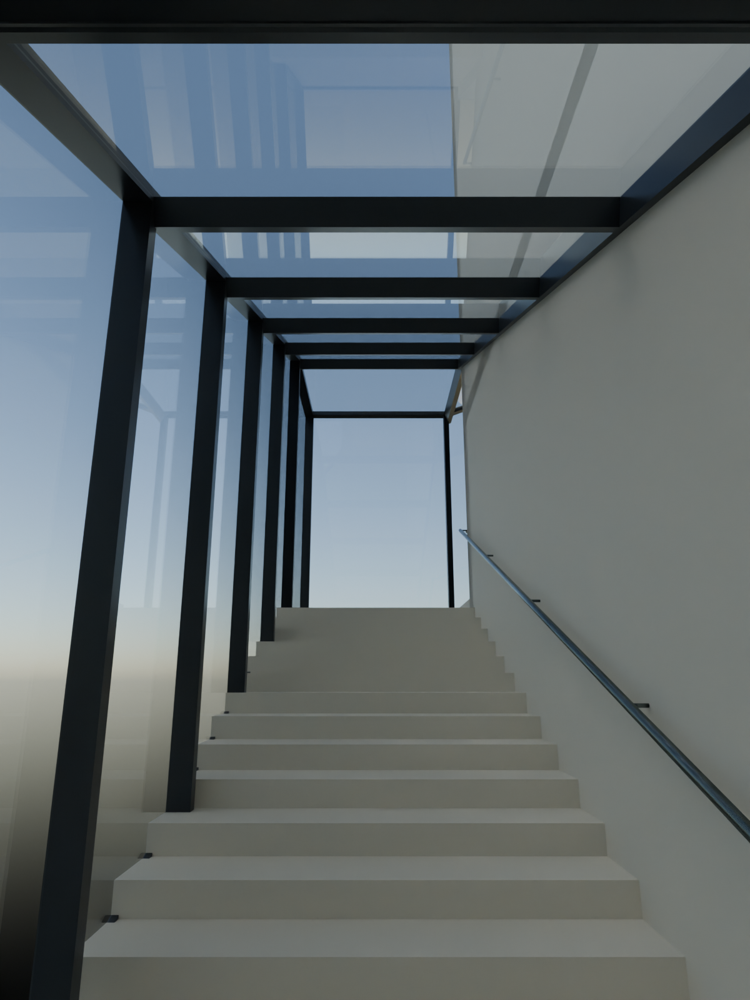
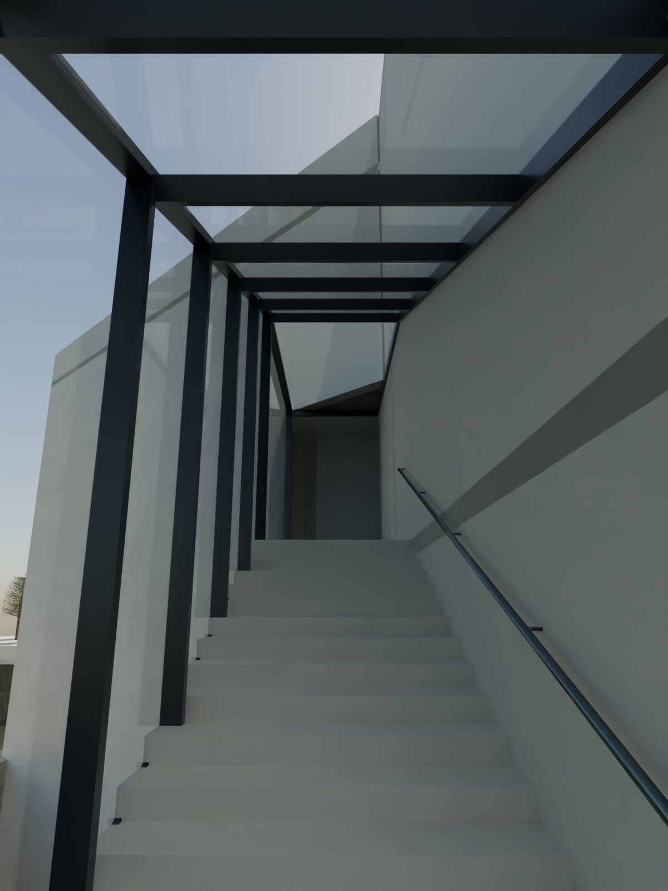
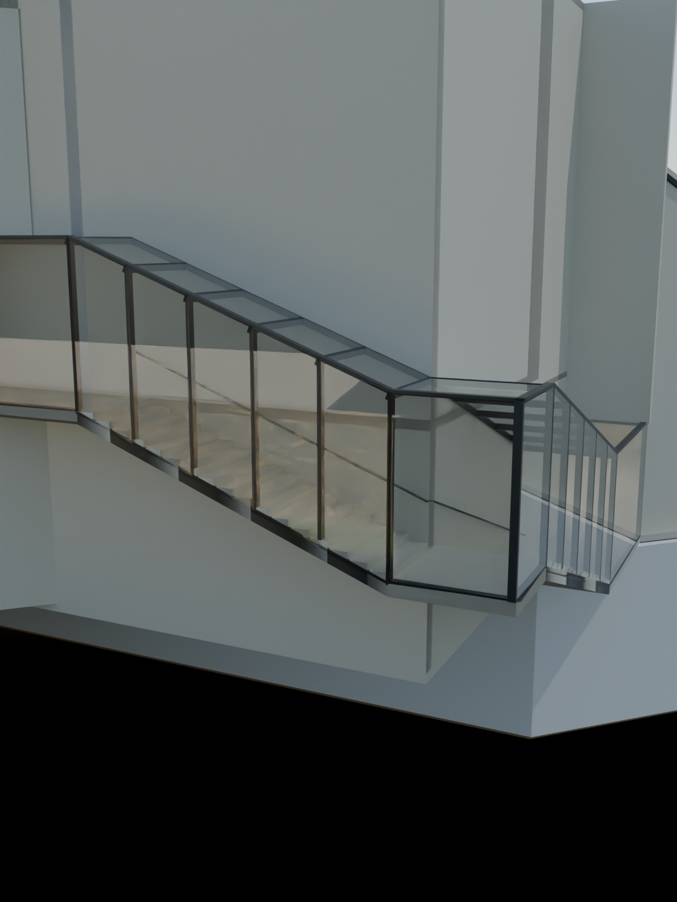

# R114 — Batı cam merdiveni kaynak karşılaştırması

Güncel R114 sahnesi yeniden açıldı; alt kol, üst kol ve dış görünüş yeniden render edildi ve üçü de açılarak incelendi. 066 iç merdiven ve 097 dış cephe fotoğraflarıyla karşılaştırıldı.

- İki yükselen camlı kol, düz köşe sahanlığı ve üst yatay galeri bağlantısı güncel sahnede bulunuyor; 097 fotoğrafındaki sistem sırası korunuyor.
- 066 fotoğrafı alt kolun cam dış kenarı, taş iç duvarı ve üst cam yüzeyini gösteriyor. Güncel alt kol görüntüsünde büyük eksik yan/üst yüzey saptanmadı.
- Eski R14 üst kol renderındaki geçide sarkan üçgen yüzey güncel R114 görüntüsünde görünmüyor. Bu turda kaldırılmış gibi sunulmaz; önceki sahne değişikliklerinin mevcut sonucudur.
- Basamak sayıları ve kot dağılımı mevcut aday değerlerdir. 066 üzerinde görülebilen rıhtların sayılması tam sistemin ölçülü doğrulaması değildir. 097 kamera eşlemesi metrik değildir.
- Bu kontrolde yeni geometri değiştirilmedi, yeni R115 kabulü oluşturulmadı, ilerleme yüzdesi yükseltilmedi. Kaynak görseldeki profil/derz ayrıntıları ve ölçü belirsizlikleri açık kalır. Diğer bölgelerin kabulü yerine geçmez.

Sonraki üretim: doğu spiral merdiveninin kat bağlantıları ve pavyon merdiveni/galeri geçişi, mevcut yerleştirilmiş kaynaklarla karşılaştırılmalı. Sadece açıklık görünmesine dayanarak duvar eklenmemeli; kaynakta kapalı olması gereken büyük sınır tespit edilirse geometri düzeltilmeli.
