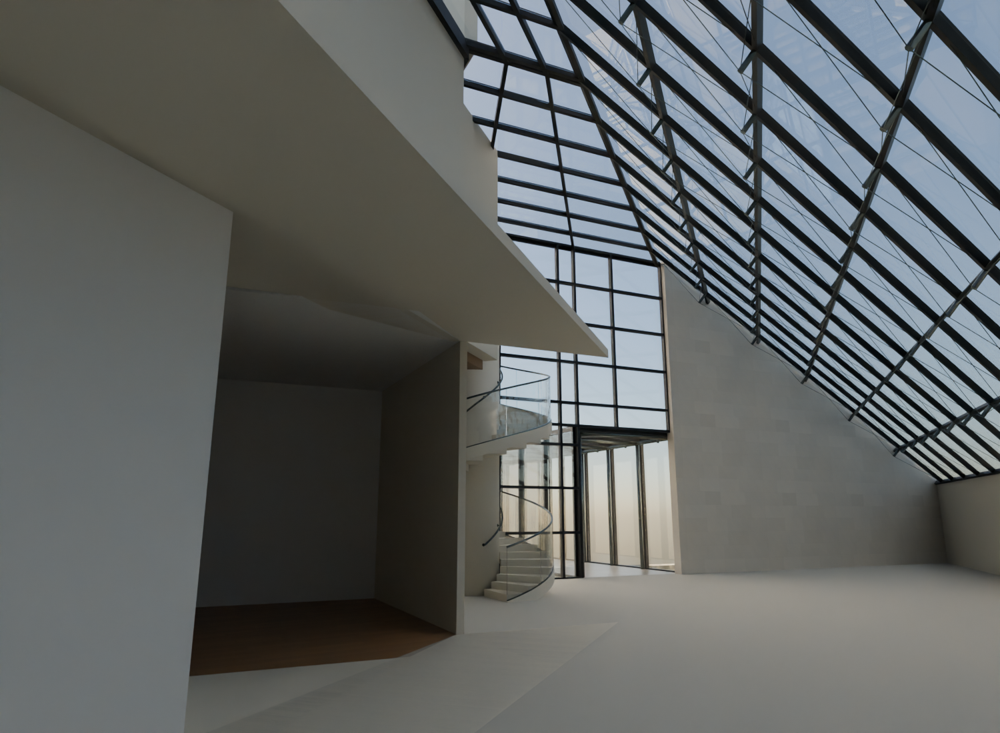
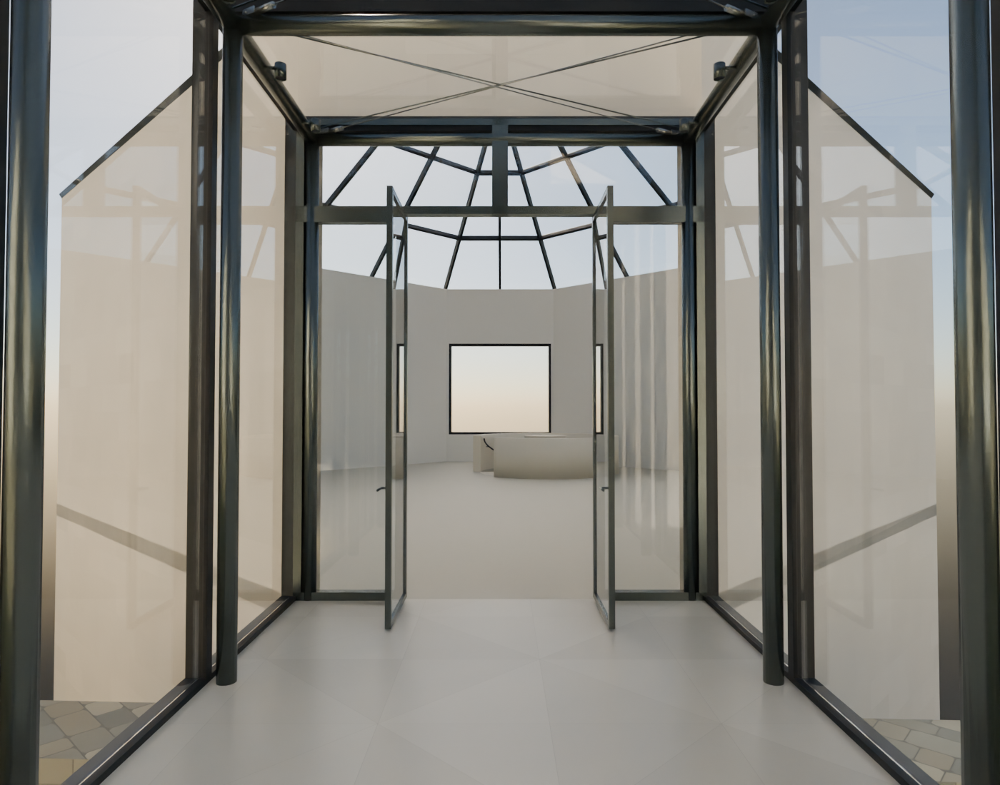
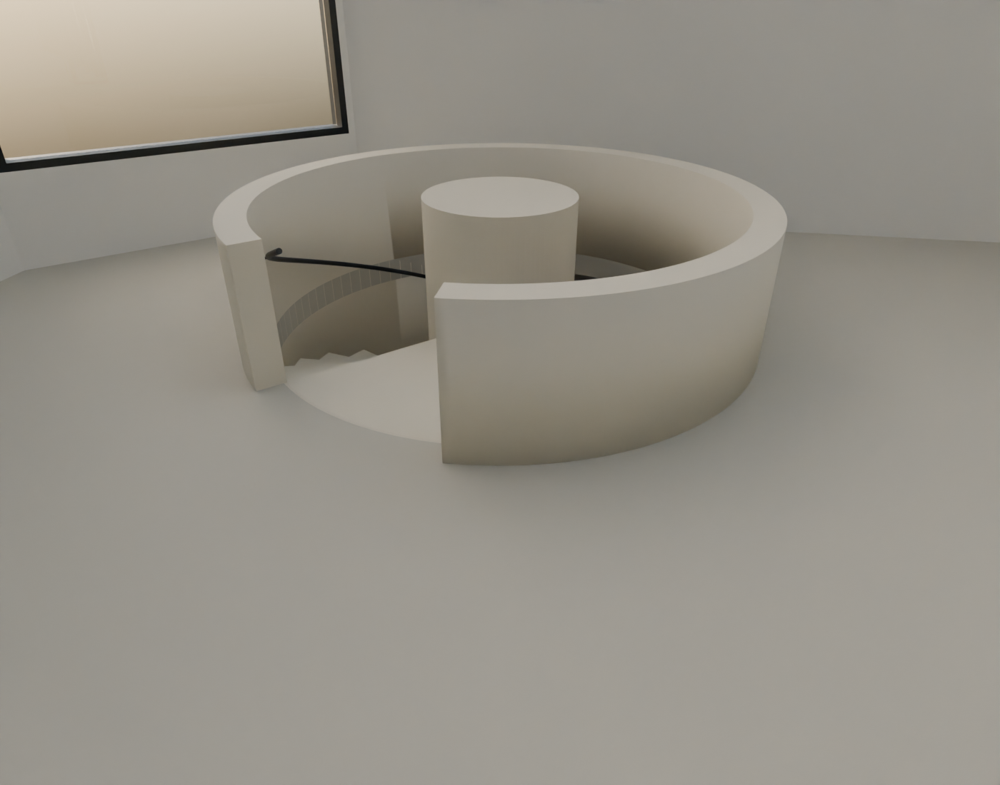
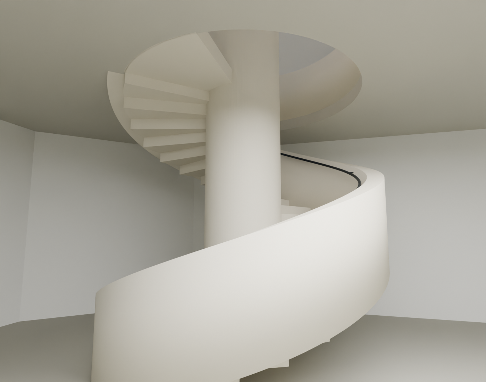
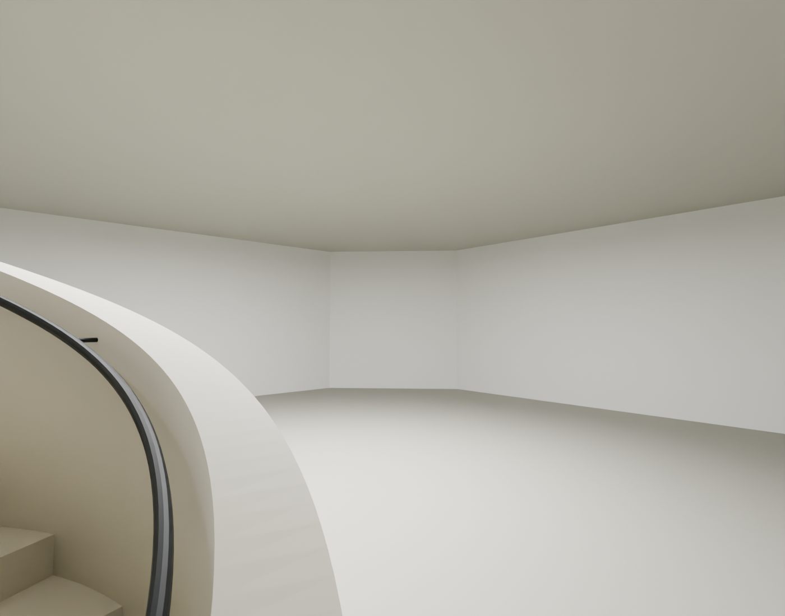

# R114 — Doğu spiral ve pavyon kat bağlantıları

Güncel sahne yeniden açılarak doğu bahçesi, pavyon girişi, iç hacim, merdiven üstü ve altı görüntüleri üretildi. Doğu bahçesi, pavyon içi, giriş, merdiven üstü ve altı görüntüleri açıldı. Kaynak 041 ve resmî PA0119 fotoğrafları doğrudan karşılaştırıldı.

- Doğu spiral: taş çekirdek, iki kıvrımlı kolun görünüşü, dış cam korkuluk ve komşu yüksek cam yüzey mevcut. Kaynak 041 sistemin varlığını destekliyor; mevcut 540 derece/34 rıht adayını ölçülü olarak doğrulamıyor.
- Pavyon: kaynak PA0119'daki taş çevre korkuluğu, üstte pencere ve aşağı inen merdiven girişi mevcut. Sanat yerleştirmesinin ipleri, heykelleri ve zemindeki sergi grafikleri eklenmedi.
- Pavyon alt görüntüsü karanlık; bu render alt katın bütün duvar/yüzeylerini görsel olarak kabul etmek için yeterli değildir. Aydınlatılmış teşhis görüntüsü gerekir; koyu alanlar otomatik delik sayılmadı.
- Özgün doğu spiral ve pavyon geçiş/baş mesafesi/döşeme kontrolleri R114 üzerinde yeniden çalıştı, bulgu yok. R114_R10_regression.json ve R114_R25_regression.json.
- Pavyonun kesin dönüş yönü, rıht sayısı ve alt çıkış geometrisi hâlâ kaynak sınırı içinde temsilîdir. Geçiş testinin geçmesi tarihî/mimari ölçü doğrulaması değildir.
- Bu turda geometri değiştirilmedi, R115 oluşturulmadı ve yüzde yükseltilmedi. Son kabul R114, son uzak yayın R113 olarak kalır.

Sonraki adım: pavyon alt katını yalnız teşhis amaçlı ışıkla görüntüle; zemin/üst örtü/duvar sınırlarını 101 kesit ve 104 planla karşılaştır. Gerçek eksik büyük yüzey varsa düzelt; bilinmeyen alt kapı veya yeni oda icat etme.

## Alt pavyon — aydınlatılmış teşhis

R114_pav_lower_lit.png ve R114_pav_lower_reverse.png aynı kayıtlı sahnede yalnız teşhis ışığıyla üretildi ve açılarak incelendi. Işık üretim sahnesine kaydedilmedi. Görülen döşeme, tavan ve yan duvarlarda büyük açık yüzey gözlenmedi; önceki koyu görünüşün kendisi delik kanıtı değildi.

101 pavyon kesit kırpımı ve 104 alt kat şeması tekrar karşılaştırıldı. 104 bağımsız sekizgen hacim ve merdiven işaretini destekliyor; 101 eski yapı/temel ilişkisini ayrıca gösteriyor. 101’deki tarihî doku sınırının bugünkü iç yüzeyde görünür olup olmadığı mevcut fotoğraflarla belirlenmedi. Bu nedenle modeldeki düz iç çevrenin tarihî yapı birleşimi kesin kabul edilmedi; sırf kesitte tarama görüldüğü için iç mekâna taş yığını eklenmedi. Hedefli resmî alt pavyon kaynak araması işe yarar yeni sonuç vermedi; geniş aramaya dönüştürülmedi.

Yeni geometri yok; son doğrulanmış sahne R114. Sonraki üretimde bu kaynağı yetersiz tarihî ayrıntı üzerinde oyalanmak yerine mevcut planın desteklediği açıklık/kat bağlantısı listesindeki açık bölgelere geç.
