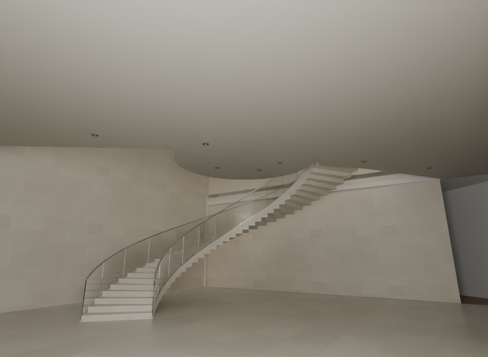
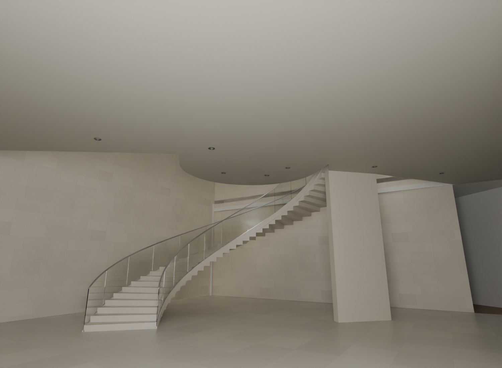

# R114 — Alt merdiven sahanlık perdesi

051 ve 052 fotoğraflarında görülen alt merdiven üst sahanlığı yanındaki eksik düşey taş perde eklendi. Aynı kamera önce/sonra görüntüsü incelendi. Yeni elemanın döşeme ve tavan temasları, alt kat geçişleri, alt merdiven regresyonu ve altı merdivenin baş mesafesi kontrol edildi.

Elemanın varlığı fotoğrafta görülüyor; yerleşimi mevcut merdiven üst kiriş hattına hizalı adaydır. 0,28 m kalınlık ve mevcut kol genişliği ölçülmüş değildir. Plan 104 bu ayrıntıyı göstermiyor. Bu paket yalnız bir temsilî mimari elemandır; bütün bina veya taşıyıcı sistem kabulü değildir. Büyük kabuk sorunları ve açık üretim işleri önceliğini korur.

- Kaynaklar: 051 ve 052 merdiven fotoğrafları; 102 planına kayıtlı mevcut merdiven. 104 alt kat şeması bu detayın ölçü kanıtı değildir.
- Sahne yeniden açıldı; önceki 9233 mesh/curve nesnesi değişmedi, yalnız bir yeni perde eklendi.
- Önce bulunmayan 25 perde yüzeyi örneği artık mevcut; üç konumda döşeme ve üst örtü teması geçti.
- Altı merdivende 2182 baş mesafesi örneği: bulgu yok. Alt galeri geçişleri ve R05 alt merdiven regresyonu geçti.
- Küresel mesh kontrolü: bulgu yok. Bu, bütün bina mimari kabulü değildir.
- Ölçü güveni D; beton/taş taşıyıcı hesabı ve kesin uygulama ölçüsü iddiası yok.

