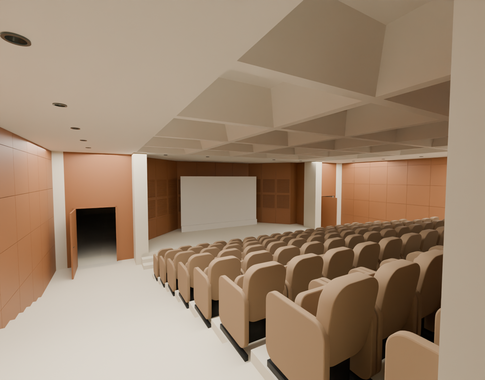
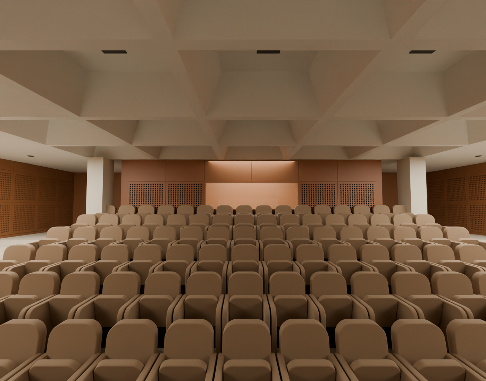

# R114 — Oditoryum kabuğu kaynak karşılaştırması

Güncel sahneden sahneye ve arka kabine bakan teşhis renderları açıldı; 071 ve LCB_auditorium3 kaynak fotoğraflarıyla karşılaştırıldı. Işıklar yalnız inceleme içindir, üretim sahnesine kaydedilmedi.

Sahne çevresindeki taş ayaklar, iki yan giriş, ahşap duvar yüzeyleri, kademeli oturma alanı ve kaset tavan mevcut. Arka görünüşte iki taş ayak, çıkıntılı teknik kabin ve pencere bandı mevcut. Açık kapıların koyu arkasını eksik duvar diye doldurmak için kaynak gerekçesi yok. Genel tavan/yan duvar kapanışında bu iki görüntüde büyük eksik yüzey gözlenmedi.

Arka kabin penceresi renderda açık kahverengi görünüyor; kaynakta koyu camlı açıklık var. R19_BOOTH_WINDOW_GLASS ve pencere çerçeveleri modelde mevcut; görüntü rengi tek başına geometri kapalı demek için yeterli değil. Sonraki hedef, bu açıklığın önünde yanlış opak mesh bulunup bulunmadığını ışınlarla kontrol etmek. Gerçek tıkanma varsa pencere açıklığını düzelt; yoksa bunu ışık/malzeme farkı olarak kaydet. Kaynaksız cihaz ekleme.

Kaset sayısı, koltuk düzeni ve donatı boyutları mevcut temsilî adaylardır; bu karşılaştırma ölçülü kabul sağlamaz. Bu turda geometri değiştirilmedi ve ilerleme yüzdesi yükseltilmedi.

## Kabin camı geometrik sonucu

Pencere bandında 6 yatay konum ve 3 yükseklikten toplam 18 ışın geçirildi. Tamamı R19_BOOTH_WINDOW_GLASS yüzeyine ulaştı. En alçak sıradaki üç ışın ayrıca mevcut son sıra koltuk sırtlarına değdi; kalan 15 ışında yalnız cam var. Açıklığı kapatan fazladan duvar/panel saptanmadı. Kahverengi görünüşe dayanarak duvar kesilmedi. Camın iç hacim/yansıma/ışık görünüşü malzeme aşamasında ele alınacak. R114_auditorium_window_probe.json nesne kimliklerini tutuyor.
