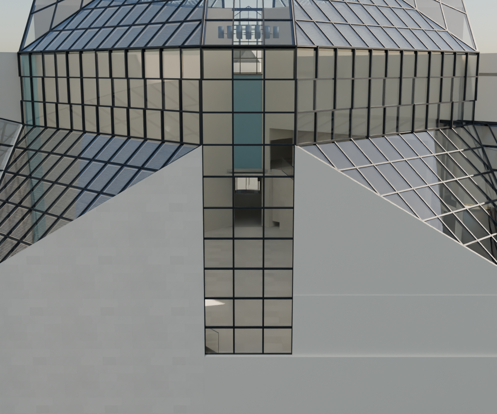
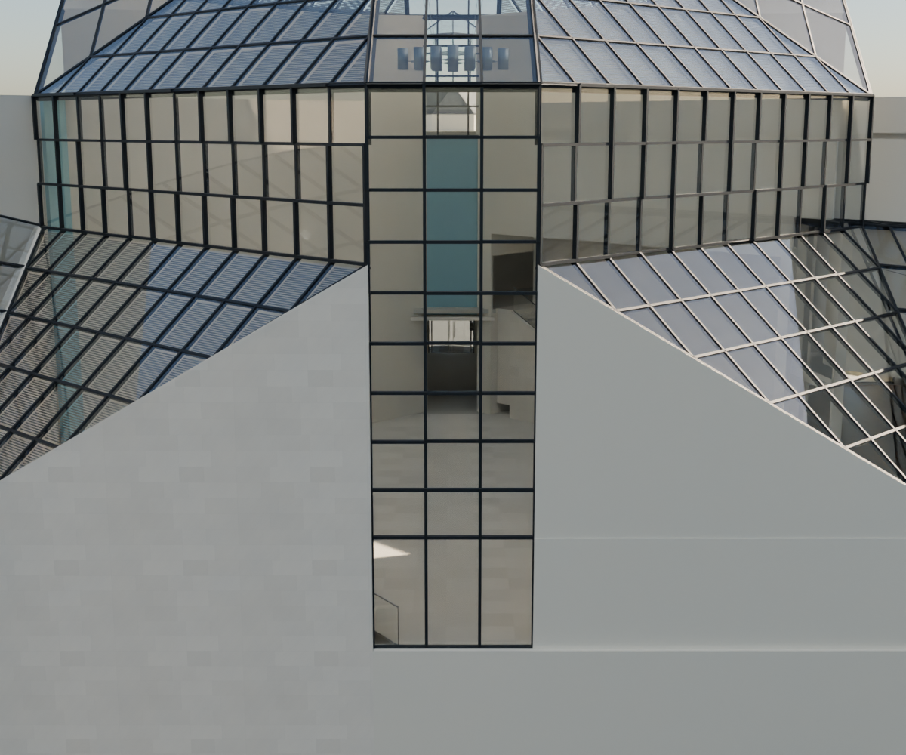

# R93 — Kuzey cam profilleri

R93: Kuzey cam şeridi yatay kayıtları yan bandın ortak kotlarına bağlandı. Önce/sonra render kontrol edildi. Önceki üç ekran görüntüsündeki duvar–çatı bağlantıları ve içeride görünen mavi temsil hâlâ açık düzeltme işi.

Kaynak 119 ve 087: yatay kayıtların devamlılığı. Mevcut yan banttaki dört kot geometri üzerinden okundu; merkez şeridin bağımsız dokuzlu bölünmesi kaldırıldı. Üç kolon korundu. Alt sıralar üstteki modül aralığını sürdürüyor, zemindeki son sıra artık ölçüyü alıyor. Kesin modül ve profil ölçüleri adaydır.

Sahne yeniden açıldı: 140.794 yüzey ışını, yatay kot karşılaştırması, kapalı geometri ve sadece bildirilen eski elemanların değişmesi kontrolleri geçti. Önce/sonra görseller aynı kameradan kontrol edildi.

