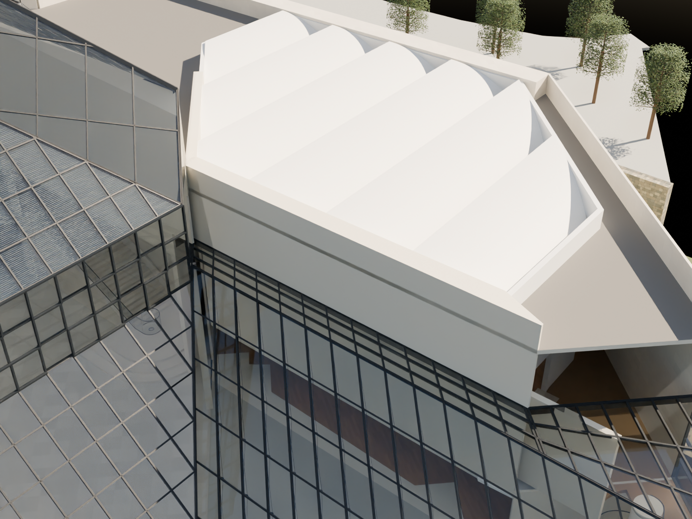
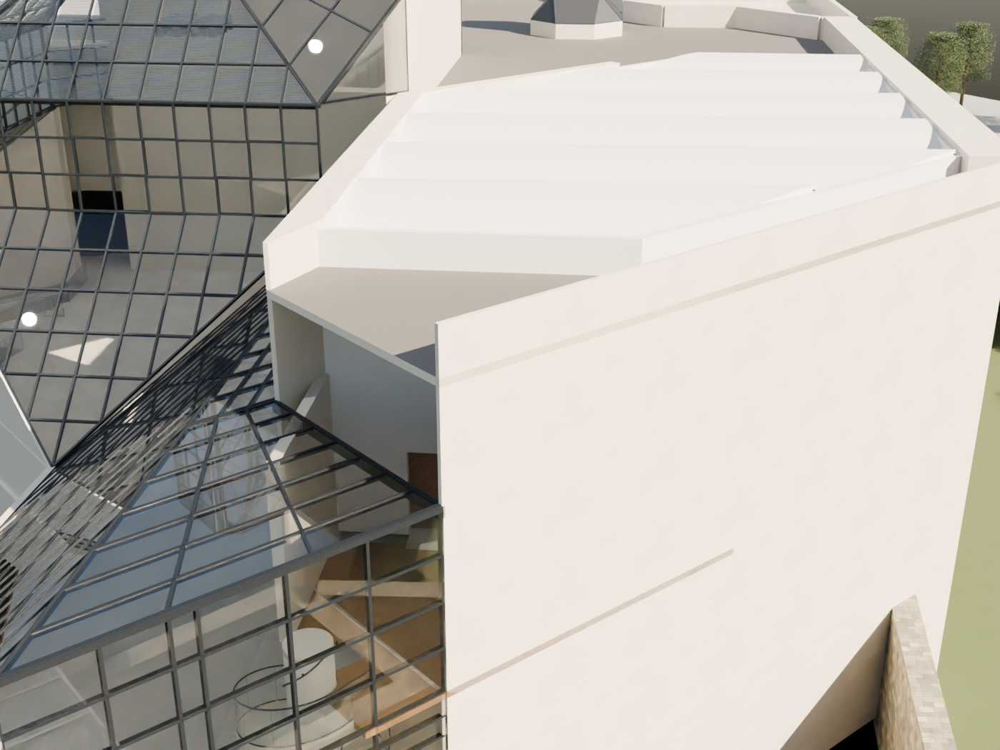
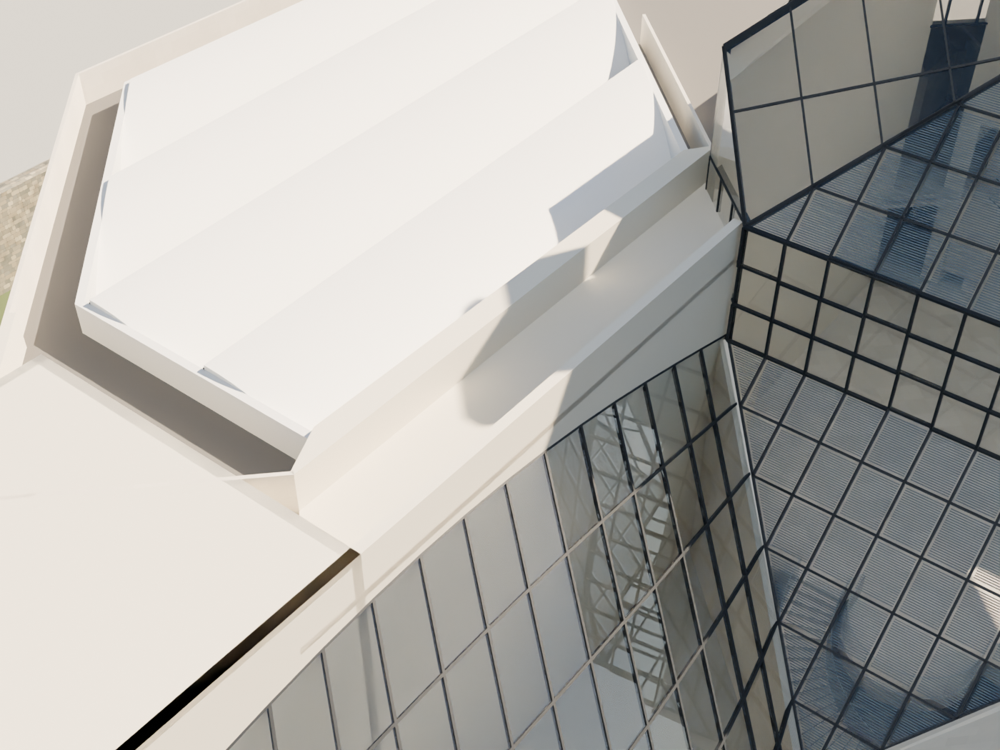

# R94 — İşaretli üç görünüşte kabuk düzeltmeleri

Son sahne: MUDAM_R94_ISARETLI_KABUK_BIRLESIMLERI_v003.blend.

| İşaret | Geometri değişikliği | Dayanak / sınır |
|---|---|---|
| Doğu uçta taşan duvar | R10 merdiven yan duvarının üst kotu R26 cam örtüsüne indirildi; alt duvar korundu. | 103 plan, 043 merdiven fotoğrafı ve mevcut örtü sınırı. Kesin üst birleşim kesiti ölçülmedi. |
| Doğu atrium–galeri köşesi | Ayrı üst duvar yüzleri mevcut geçiş başlığı üzerinde birleştirildi. | 102/103 ve mevcut iki sınır; alt geçişler korundu. |
| Batıdaki iki duvar arası boşluk | Mevcut ana çatı seviyesinde yatay ara örtü üretildi; hacim tam boy duvarla doldurulmadı. | 093, 116 ve mevcut sınırlar. 12.723118 m model kotudur, ölçülmüş gerçek kot değildir. Drenaj/katmanlar açık. |
| Batı atrium köşesindeki mavi yüzey | Eski tam boy cam temsili kaldırıldı; 026’daki açık alt geçiş korundu, üstte 9 cam ve 8 profil üretildi. | 026, 093; 3×3 modül ve profil kesitleri aday. |
| Atriumda görünen diğer mavi yüzey | Eski iç bölme kalıntısı kaldırıldı. R90 dış cam ve alt geçiş korundu. | Kalıcı iç ekran olduğu doğrulanmamıştı. Kesin iç başlık düzeni açık. |

Yeniden açılmış sahne: 42.622 yerel cam yüzeyi örneğinde boşluk yok; global mesh ve değişiklik kapsamı kontrolleri geçti. 33 tanımlı bölgede 6.216 noktadan yapılan zemin/örtü/yan sınır taramasında eksik bulunmadı. Bu örnekleme tüm binanın ölçülü kabulü değildir.

Aynı üç kameradan son geometri kontrol edildi. Önceki R92 görüntüleri karşılaştırma için korundu. Batı küçük çatı ucundaki birleşim, köşe profil sürekliliği ve kesin ara örtü biçimi tamamlanmış sayılmadı.

## Doğu birleşimi

## Doğu uç

## Batı birleşimi

