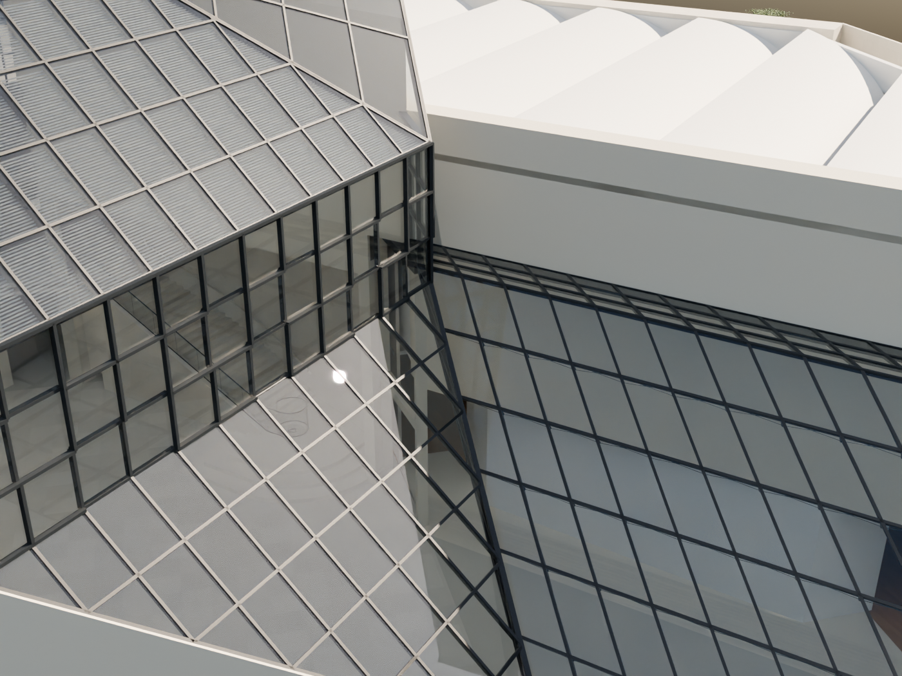
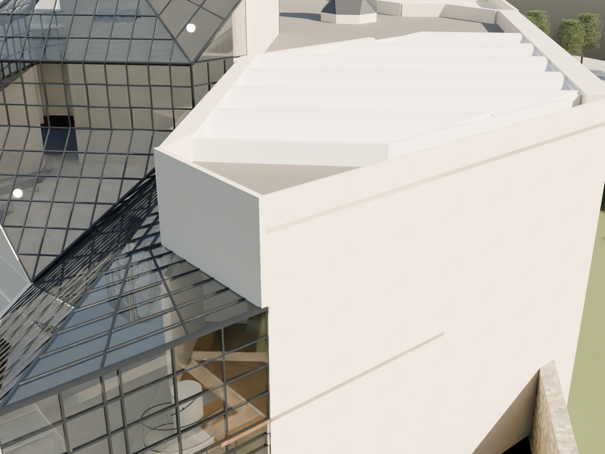
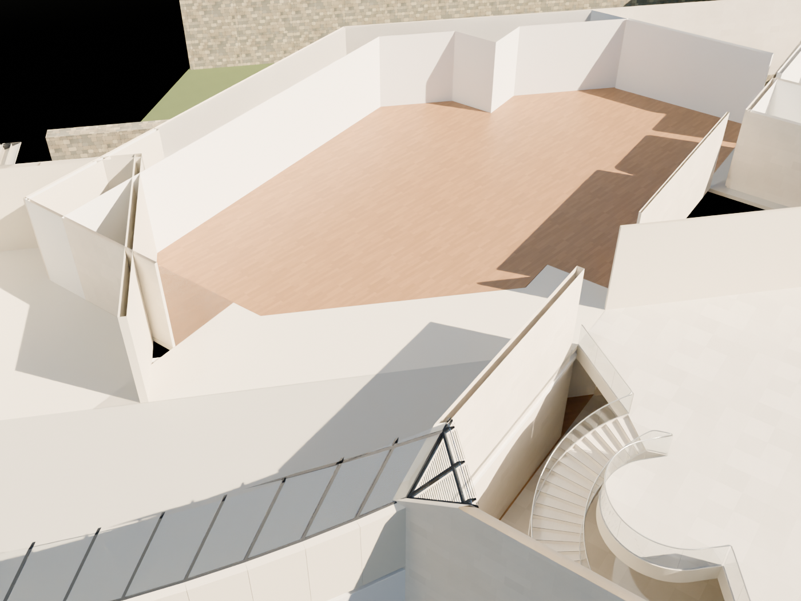
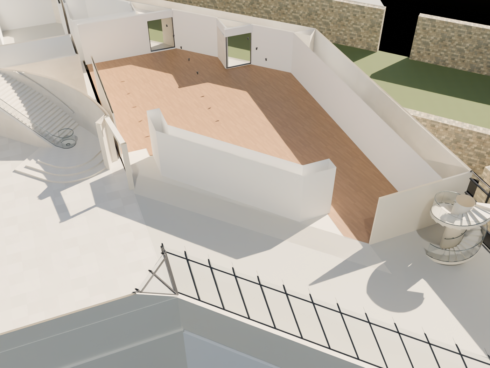

# R95 — Beş ekran görüntüsüne bağlı düzeltmeler

R95: Kullanıcının SS1–SS5 işaretleri ayrı düzeltildi. Cam kenar şeridi/dönüşü ve dış uç duvarı eklendi; kafe zemin katındaki yanlış duvar uzantısı kaldırıldı; yanlışlıkla kaldırılmış doğu giriş duvarı geri kuruldu. Önce/sonra aynı 84 yerel kontrolde R94’ün 75 başarısızlığı R95’te sıfır. Dış görünüşler ve iki zemin kat kesit görünüşü incelendi.

Önceki genel kapanış taraması bu yerel hataları yakalamadı. Bu pakette her işaretin hedef noktaları önce R94 sonra R95 sahnesinde aynı ışınlarla denetlendi. Yeni sahne yeniden açıldı; global mesh ve değişiklik kapsamı kontrolleri geçti. 8.316 cam yüzeyi örneği geçti; sayısal BVH toleransı 0,01 mm.

## SS1_SS2

Eksik eğimli cam bağlantı şeridi, dik dönüş ve köşe birleşimi üretildi.

Önce başarısız: 15; sonra: 0.

## SS3

Yan cam örtü üzerinde dış uç duvarı kapatıldı; merdiven geçişi aşağıda korundu.

Önce başarısız: 15; sonra: 0.

## SS4

Kafe arka duvarının yanlış zemin kat uzantısı kaldırıldı. Üst duvar korundu.

Önce başarısız: 15; sonra: 0.

## SS5

R92 sırasında yanlış kaldırılan doğu galeri giriş duvarı kaynak plan iziyle geri kuruldu. Batı duvarı geri eklenmedi.

Önce başarısız: 30; sonra: 0.

## Kaynak ve sınırlar

102 ve PDF2016 doğu galeri giriş duvarının izini verir. Batıdaki kaldırma isteği doğuya otomatik uygulanmamalıydı; R92’deki bu hata düzeltildi. Kafe tarafındaki üst duvar fotoğrafından zemin kat duvarı çıkarımı geri alındı. Cam birleşimi mevcut iki çatı kenarı arasında üretildi. Dış uç duvarı mevcut uç izini izler ve cam örtü kotundan başlar. Kesin kalınlık, yükseklik, profil kesiti ve gizli birleşim katmanları hâlâ adaydır.

İki kesit görünüşünde yalnız inceleme için z=4,2 m üzeri shader ile saydamlaştırıldı; bu kesme Blender modeline veya GLB’ye kaydedilmedi. Kameralar yaklaşık inceleme kameralarıdır; fotoğraf metrik eşleştirmesi değildir. Tüm binanın kaynak kabulü bu paketle tamamlanmış sayılmadı.
