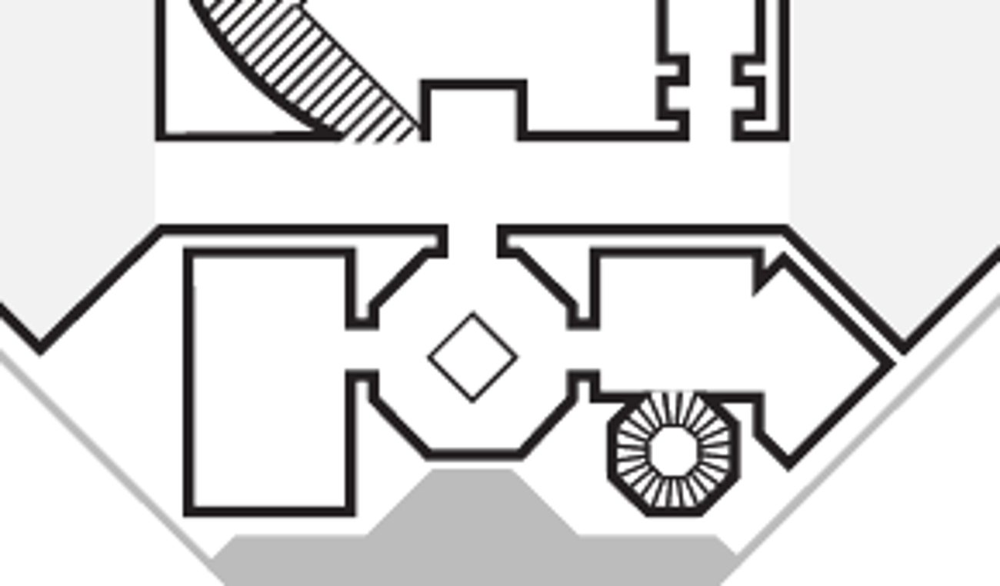
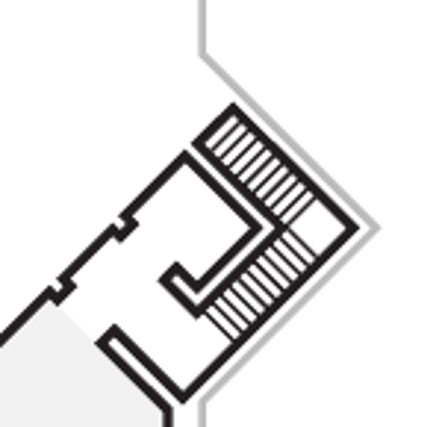
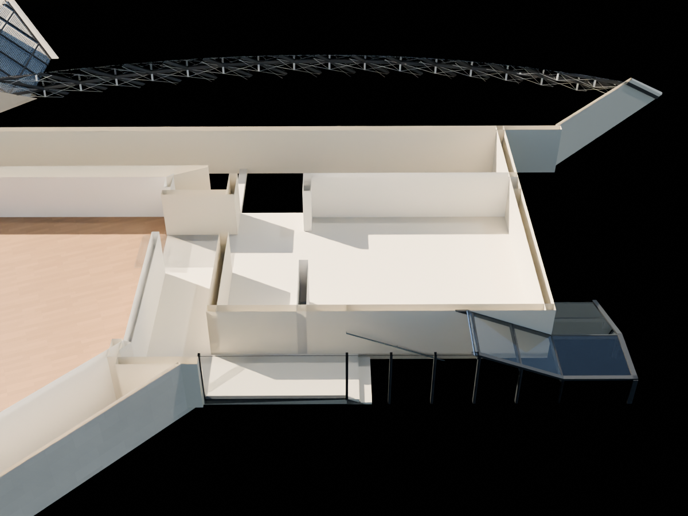
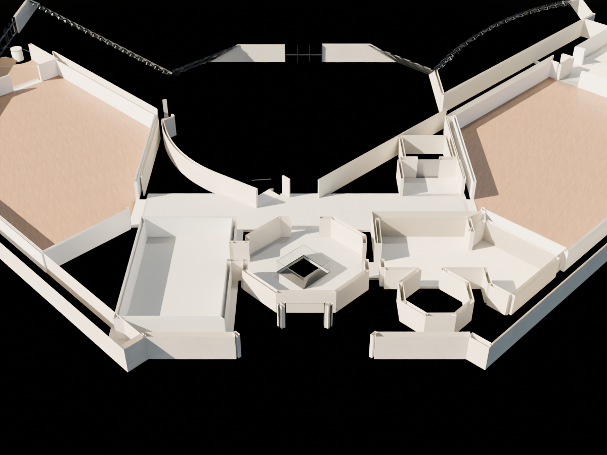
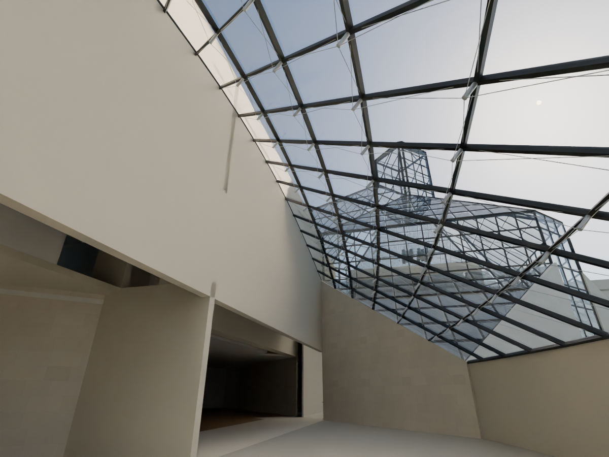
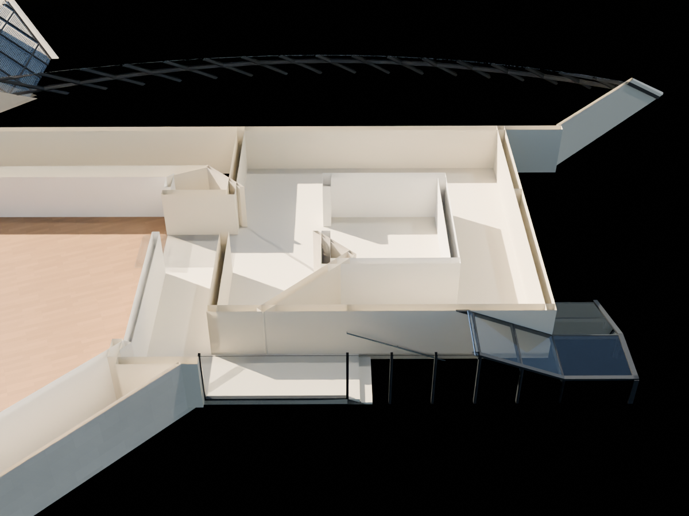
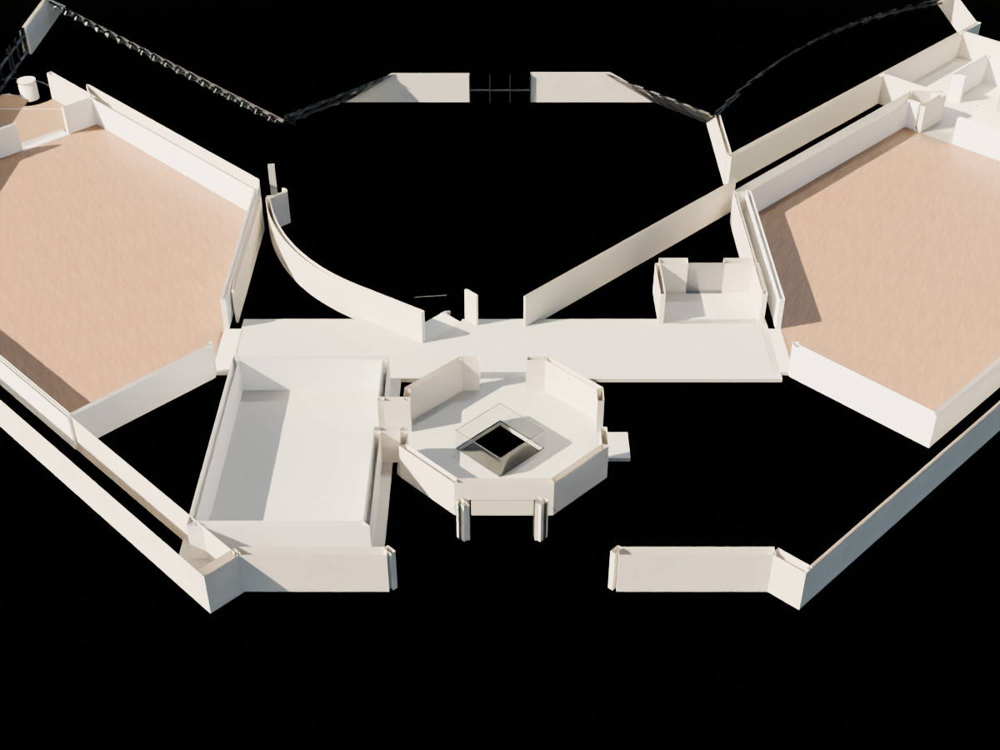

# R96 — Üst kat duvarları, eksik oda ve kafe çatı taşıyıcıları

R96: Küçük batı galerisini kesen iki eski zemin kat duvarı üst döşeme altında sonlandırıldı. 2016 iç oda ile 103 merdiven kabuğunun farklı ölçekleri uzlaştırıldı; iki iç duvar kopyası kaldırıldı, kafe üzerine taşan +1 döşemesi daraltıldı. Okuma alanının doğusundaki eksik oda, servis merdiveni sınırı ve üst asansör kuyusu yüzleri kaynak planıyla üretildi. Kafe çatısına fotoğrafta görünen alt çubuk sistemi aday ölçülerle eklendi.

## Yapılan geometri değişiklikleri

- `P05_GALLERY_HALL_WEST2` ve `R14_GALLERY_WALL_RETAINED`: alt kattaki duvarlar korundu, +1 içinden geçen eski uzantılar üst döşeme altında sonlandırıldı.
- Petite Galerie Ouest: farklı referans ölçeklerinden doğan iç içe oda hatası giderildi. Oda sınırı resmî103 merdiven iç yüzlerine yerel iki eksenli kayıtla oturtuldu. R87 iç arka/yan kopyaları kaldırıldı; üst döşemenin kafe izdüşümüne taşan kısmı kesildi. Kapı oranı2016 planından aktarılmış adaydır.
- Documentation doğusu:2016 +1 planının açıkça gösterdiği, önceki modelde eksik oda döşemesi, duvarları ve tavanı eklendi. Köprü/galeri bağlantıları kapatıldı. Sekizgen servis merdiveni çevresi üretildi; merdiven boşluğu doldurulmadı.
- Asansör: üst planın çizdiği üç eksik kuyu yüzü eklendi. Alt katlar boyunca kuyu uyumu bu paketle onaylanmadı.
- Kafe cam çatısı: fotoğraftaki aşağı alınmış düğüm ve çubuk sistemi eklendi.425 parça, mevcut18×6 aday ızgaraya bağlıdır. Düğüm düşümü0,42m; kalın destek0,085m ve ince çubuk0,012m ölçülmüş değildir.

## Kaynak kontrolü

2016 planı ile resmî103 şeması küçük galeride farklı oranlar verir. R87 bu ikisini ayrı parçalar hâlinde birleştirerek yanlış bir iç oda oluşturmuştu. Bu pakette mevcut103 merdiven sınırları ortak referans alındı; ölçek farkı gizlenmedi. Yerel kayıt metrik rölöve kabulü değildir.

Resmî kat sayfası web aracında404 verdi.2023 müze PDF'sinin indekslenmiş metni bulundu fakat plan görüntüsü indirilemedi; bu dosya geometri kanıtı olarak kullanılmadı. Kaynak karması ve SHA-256 kayıtları `R96_source_record.json` içindedir.

## Görsel kontrol

Kesitlerde yalnız4,64–6,65m aralığı görünür; bu inceleme shader'ı model veya GLB'ye kaydedilmez. Siyah alanlar bu kesit aralığında görünmeyen yüzeylerdir, tümünün gerçek bina boşluğu olduğu iddia edilmez. Kafe görünüşünde yükseklik kesmesi yoktur.

## Açık işler

Servis merdiveni basamakları ve alt kat devamlılığı; gizli tavan/çatı katmanları; tüm yapının birleşik plan-kesit ölçek uyumu; profil ankrajları ve imalat ölçüleri açık. Sanat eseri veya geçici sergi bölmesi eklenmedi. Tüm bina veya bütün +1 ayrıntıları tamamlandı sayılmadı.

## Kaydedilen sahnenin doğrulaması

579 yerel geometri/boşluk/önceki paket kontrolü geçti; 9 eski duvar çakışması örneği yeni sahnede yok. 8346 görünür mesh için sayısal/topolojik hata bulunmadı. Bu tarama mimari doğruluk onayı değildir. 10 eski nesne izinli kapsamda değişti; diğer geometri korundu.

### Aynı kameradan önceki hâl

