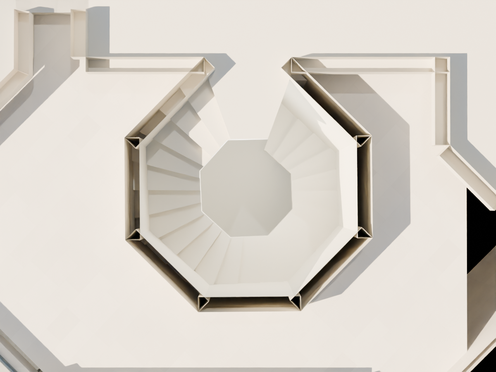
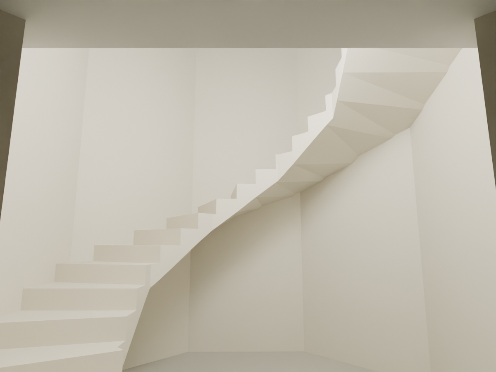
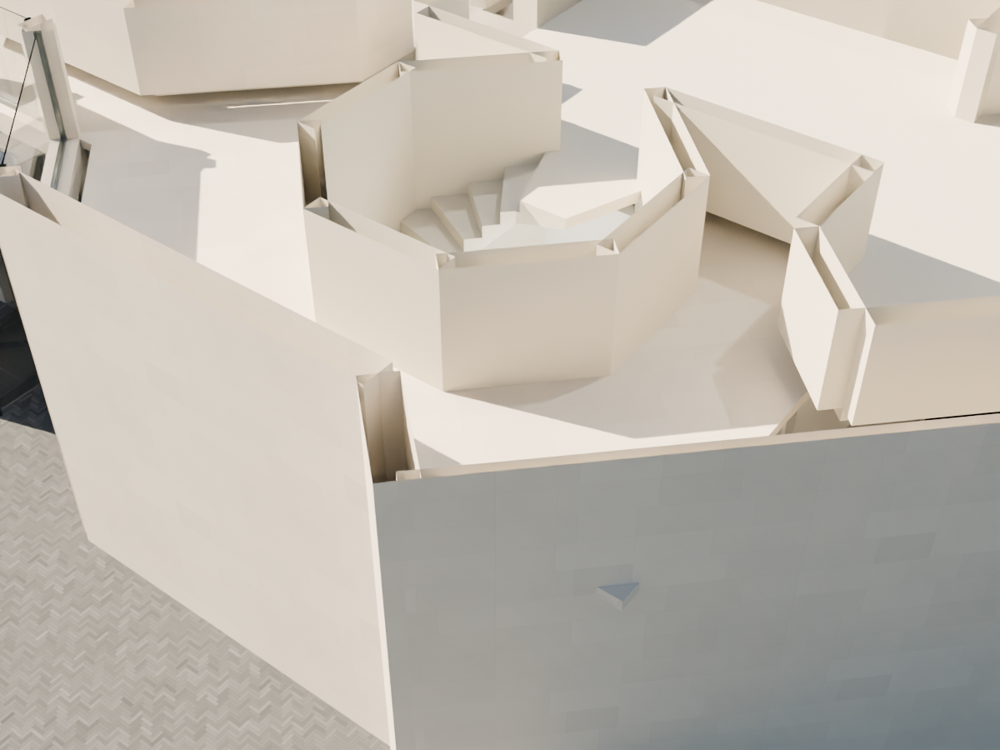

# R97 — Servis merdiveni ve kat bağlantısı

Yerel sahne: `MUDAM_R97_SERVIS_MERDIVENI_v003.blend`. R96 üzerine 24 basamak/sahanlık parçası eklendi. Yedi kuyu duvarı zemine devam ettirildi; `R39_PUBLIC_CEILING_18` yalnız merdiven kuyusunda kesildi, `R33_WALL_SERVICE_W_N` girişinde geçit açıldı.

Kaynak: `08_Belgeler/Mudam_Wim_Delvoye_2016_kat_semalari.pdf`, sayfa 5, 68–93 numaralı vektör yolları. İç sekizgen ve dış kuyu izi bu plan ile mevcut R96 sınırına dayanır. 70–93 yollarındaki 24 grafik bölme, doğrulanmış imalat rıhtı değildir. 4,859 m kat farkı önceki koşullu kotlardan gelir; 24 eşit yükselme, dönüş yönü, 40° üst sahanlık ve 180 mm gövde kalınlığı adaydır. Gizli taşıyıcı veya merkez kolon eklenmedi.

## Kontroller

- Kaydedilen sahne yeniden açıldı. 110 yerel kontrol: basamak yüzeyleri, ardışık alt yüz temasları, giriş döşemeleri, iki kat geçidi, orta boşluk ve yürüyüş hattının merkezinde 2,10 m baş mesafesi geçti. Bu örnekleme güvenlik mevzuatı veya bütün basamak genişliği onayı değildir.
- R95 ve R96 duvar/cam kontrolleri yeni sahnede geçti.
- 8.370 görünür mesh genel taramasında açık mesh, sıfır alanlı yüz ve sayısal hata kalmadı. İlk denemede bulunan sıfır alanlı bir yüz v003'te düzeltildi.
- Miras geometri karşılaştırmasında yalnız bildirilen dokuz mevcut parça değişti.
- Aşağıdaki görseller yeniden kaydedilen v003'ten üretildi ve incelendi. Kesit görsellerinde üst yüzler yalnız görüntüleme için kırpılır; modelde silinmez. Giriş görüntüsündeki inceleme ışığı sahneye kaydedilmez.

## Açık işler

Servis merdiveninin iç fotoğrafı ve ölçülü kesiti yok. Gerçek rıht sayısı, dönüş yönü, korkuluk, alt kata/çatıya devam ve taşıyıcı kesiti doğrulanmadı. Aday geometri bunları kesinleştirmez. Kabuk için 34 bölge taramasının örneklenen zemin/üst örtü noktaları geçse de bütün binanın kaynak uyumu kabulü tamamlanmadı.

Pano yüzdesi beş geniş iş adımının puanıdır; ara geometrik düzeltmeleri sayan bir üretim sayacı değildir. Bu pakette açık kabul adımları tamamlanmış gösterilmedi. Panonun güncelleme listesi artık tarihsiz R-sürüm paragraflarını da gösterir.
