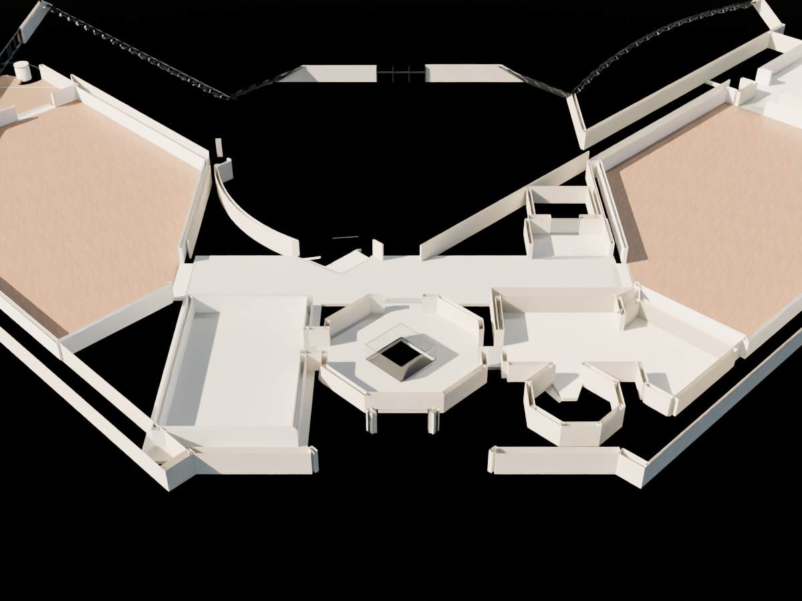

# R98 — +1 köprü duvar taşması

103 üst kat planı üzerine R97 yatay mesh kesiti çizildi. `R45_STAIR_RECESS_CONTINUOUS` köprünün kuzey kenarını aşarak geçişe uzanıyordu. Bu duvar, `R04_RECESS_HEAD` ve `R04_RECESS_TOP_LINTEL` yalnız +1 döşeme üstünde ve canonical y=555,5 sınırının köprü tarafında kesildi. Alt kat duvarı, bütün basamaklar ve döşemeler korundu. Kaynak ziyaretçi planıdır; sınır ölçülmüş rölöve hassasiyeti taşımaz.

Kaydedilen R98 yeniden açıldı. Önce ve sonra aynı 118 yerel ışın kontrolünde 116 taşma sıfıra indi. Sınırın yanında iki ışın doğru bırakılan duvar uç yüzüne dokunur; kabul kararı vuruş koordinatının kaynak sınırını aşmamasına dayanır. 8.370 mesh genel geometri taraması ve yalnız üç bildirilen parçanın değiştiği karşılaştırma geçti. Servis merdiveninin 110 kontrolü de geçti.

## Aynı kamera ve aynı kesit kotu

Önce:

Sonra:

Görsellerde üst kat döşemesi altı ve döşemeden 1,20 m üstü görüntüleme için kırpılır. Siyah bölgeler görüntüleme dışında bırakılan hacimlerdir; tümü eksik döşeme veya gerçek boşluk olarak yorumlanmamalıdır. Model görüntüleyicisine aynı amaçla “Kat planı kesiti” düğmesi eklendi; yalnız görünümü değiştirir.

## Hâlâ açık

Kullanıcının işaretlediği asansör çevresi, Studio ve servis odasının dış alanları bütün kat ilişkileriyle henüz kabul edilmedi. Son iki ekran görüntüsündeki galeri boyunca duvar–döşeme boşluğu ve merdiven yanı galeri köşesi de açık iş. Bu rapor veya geçen mesh testleri bu bölgelerin çözüldüğü anlamına gelmez.
