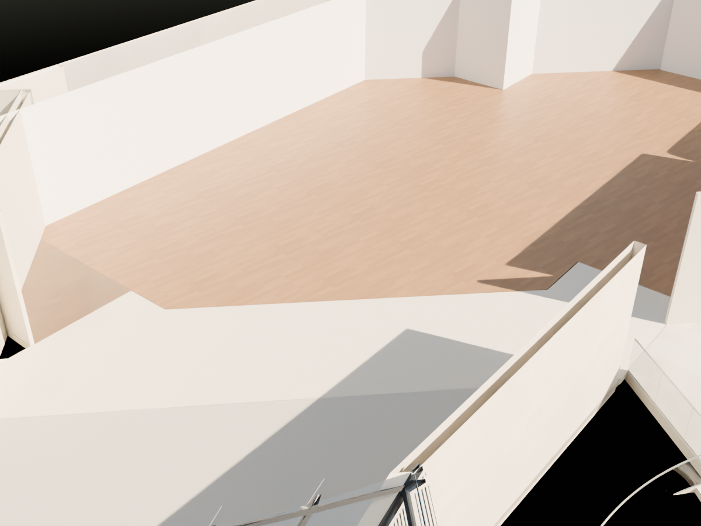
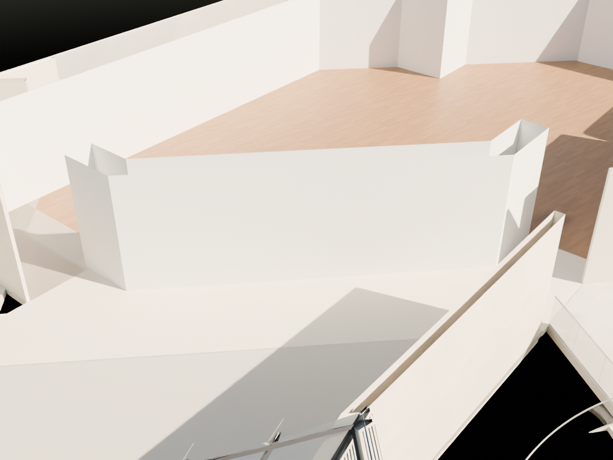

# R99 — Batı galeri giriş sınırı

`MUDAM_R99_BATI_GALERI_GIRIS_DUVARI_v002.blend` R98 üzerine kuruldu.

102 zemin kat şemasında ve 2016 planında görünen kısa kırıklı batı galeri giriş duvarı yoktu. `ground_gallery_access.json` içindeki W izi kullanılarak yeniden kuruldu; alt kot 0, üst kot mevcut galeri tavanı 4,35 m. Kalınlık ve yükseklik ölçülmüş değerler değildir. Bu parça daha önce kaldırılması istenen uzun kafe diyagonal duvarıyla aynı parça değildir.

Kuzey girişini eski `R87_VOLUME_FRONT_LOW` kapatıyordu. Üst kattaki küçük odanın sınırından türetilmiş bu zemin kat devamı 102 planındaki açık dolaşıma aykırı olduğundan görünür modelden çıkarıldı. Eski kaynak nesne dosyada saklandı.

## Doğrulama

Kaydedilen v002 yeniden açıldı. Duvar üzerinde üç yükseklik ve beş istasyondaki 15 eksik sınır kontrolü önceden başarısızken şimdi geçti. Kuzey ve güney geçitlerinde üç yükseklikte altı tam sahne ışını açık. İlk denemede kuzey yolu kapanıyordu; bu nedenle v001 kabul edilmedi. 8.370 görünür mesh sayısal ve kapalı yüzey taraması geçti. Karşılaştırmada yalnız `R87_VOLUME_FRONT_LOW` görünürlüğü değişti ve bir duvar eklendi.

Önce:

Sonra:

Aynı kamera, 4,20 m inceleme kesiti. Tavanlar yalnız inceleme renderında kırpılır; üst kat geometrisi silinmez. Görseller v002 kaydından üretilip incelendi.

## Açık kalanlar

Kullanıcının ikinci merdiven yanı galeri köşesi işareti henüz kapatılmadı. 026 fotoğrafında yüksek bir geçit görüldüğünden bu alan gelişigüzel duvarla doldurulamaz; ekran görüntüsündeki her birleşim ayrı eşleştirilecek. +1 katın Studio/servis/asansör çevresi bütün kat ilişkileriyle kabul edilmedi. Bu paket tüm ekran görüntülerinin veya bina kabuğunun çözüldüğünü göstermez.
